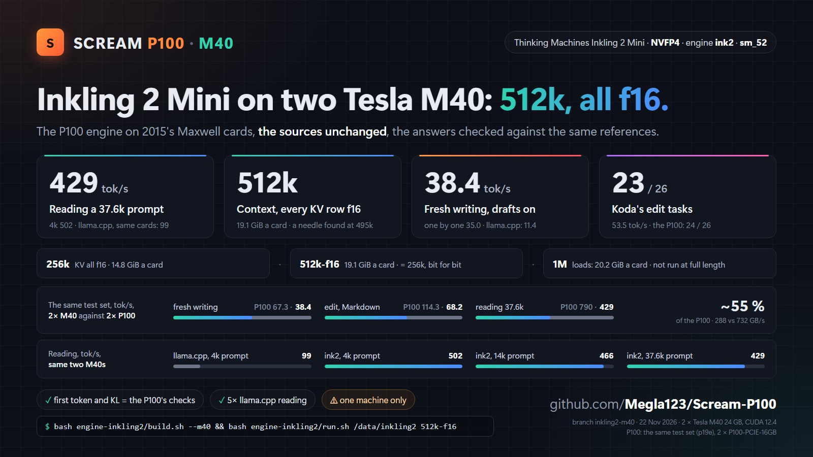

# Inkling 2 Mini on two Tesla M40 24 GB



The `ink2` engine of [docs/INKLING2.md](INKLING2.md) also runs on two **Tesla M40 24 GB** (Maxwell, sm_52, 2015). The
sources are the same, byte for byte, as the P100 build (p19e); only the compile target changes (`build.sh --m40`). Measured on
22 Nov 2026 on our second server: HPE DL380 Gen10, 2× Tesla M40 24 GB, each on its own PCIe 3.0 x16 link, app clock
1114 MHz, power limit 220 W, 30 GiB RAM, CUDA 12.4, driver 580. Only the **24 GB** M40 was run.

```bash
git clone -b inkling2-m40 https://github.com/Megla123/Scream-P100.git && cd Scream-P100
bash engine-inkling2/build.sh --m40                 # build/ink2_v1 for sm_52, ink2_vis + llama-tokenize on the CPU
bash engine-inkling2/setup.sh /data/inkling2        # model 17.6 GB + drafter 0.4 GB + projector 0.64 GB, a venv
bash engine-inkling2/run.sh /data/inkling2 512k-f16 # 512k, every KV row in f16 (19.14 GiB a card); or 256k
```

CUDA 13 has no sm_52: use CUDA 12.x (and a host compiler nvcc accepts, `HOST_CXX=g++-13` with CUDA 12.4).

Checked from a clean clone of this branch on the M40 server (22 Nov 2026, 14:51-15:01): `build.sh --m40` builds for sm_52,
`run.sh DATA 512k-f16` loads with every KV row in f16 (19,817 MiB a card), `tools/picture_check.py` reads the title of its picture,
`tools/bench.py` gives fresh 39.8 tok/s, edit 41.7 tok/s, a 34,699-token read at 434.0 tok/s and 33.0 tok/s writing after it.

## It gives the same answers

Checked against the llama.cpp references of the P100 work (llama.cpp `690b87d`, the same prompts and files):

| Check | 2× M40 | 2× P100 |
|---|---|---|
| writing path, en / sl / code prompts: first token of every row | 13/13, 6/6, 4/4 the same | the same |
| writing path, KL of the last row en / sl / code | 0.00010 / 0.02546 / 0.00001 | 0.0001 / 0.025 / 0.00001 |
| reading path, 32 greedy tokens against llama.cpp | 32/32 in all three | 32/32 |
| 4,096-token prompt, last row KL against llama.cpp (reading / writing path) | 0.0117 / 0.0145 | 0.0107 / 0.0145 |
| `512k-f16` against `256k`, last row after 14k and 40k tokens | identical to the bit | (the P100 has no room for it) |

The drafts are checked by the model, so they never change what it says; as on the P100, a window of several tokens is not
the same to the bit as one token at a time, so a greedy text can part at a near tie (in one edit test at token 250).

## Speed

The shared tests of the P100 page (the Flash-Next A/B prompts) at a 262,144 context, the DSpark drafter and prompt lookup on:

| Test | 2× M40 | 2× P100 (p19e) |
|---|---:|---:|
| fresh writing (12 prompts) | **38.4 tok/s** | 67.3 |
| edits, Python / Markdown (1,600 tokens of reasoning each) | **51.1 / 68.2** | 75.3 / 114.3 |
| reading 37,602 tokens / writing after it | **429 / 32.6** | 790 / 53.2 |
| new tokens on a running conversation, 1.8k ... 24.5k | **481 ... 307** | 889 ... 536 |
| Koda's 26 edit tasks (hidden tests) | **53.5 tok/s, 23/26** | 97.4 tok/s, 24/26 |
| one token at a time, no drafts | 35.0 | 56.6 |
| reading 4,096 / 14,336 tokens | 502 / 466 | ~940 / ~887 |

llama.cpp `690b87d` on the same two M40 (`llama-bench`, layers split, `-ot` as on the P100): **99 tok/s** reading 4,096
tokens, **11.4 tok/s** writing. `ink2` is 5.1 times faster at reading and 3.1 times at writing (3.8 with its drafter).

The M40 runs at ~57 % of the P100's writing speed and ~54 % of its reading speed. Its memory is 2.5 times slower (288 against
732 GB/s) and its f32 is 6.8 against 9.3 TFLOPS on 24 instead of 56 SMs; the kernels were tuned on the P100. A profile
(`nvprof`, one token at a time) has the dense Q8 GEMVs at ~44 % of the M40's bandwidth, the NVFP4 expert rows at ~50 % and the
loop controllers at ~17 %; the expert GEMM of the reading path reaches ~3.4 TFLOPS a card (~50 % of peak, the P100 ~65 %). Kernels
tuned for Maxwell might add roughly a quarter to writing and less to reading; not done.

## Memory and context

VRAM a card with the drafter, as the server runs it:

| Context | `ink2_v1` GiB | nvidia-smi MiB |
|---|---:|---:|
| 262,144 (`256k`) | 14.76 | 15,331 |
| 524,288, KV int8 past 32k (`512k`) | 15.24 | 15,827 |
| 524,288, all KV in f16 (`512k-f16`) | 19.14 | 19,817 |
| 1,048,576, KV int8 past 32k | 20.18 | 20,889 |

A needle in the first line of a **495,294-token** prompt was found with `512k-f16` (reading 4,227 s = 117 tok/s on average,
writing after it 14.3 tok/s; the P100's `512k` took 3,041 s for 496k). The model's full context, 1,048,576, **loads** on the
24 GB cards, but it was not checked with a full prompt (`run.sh` stops at 524,288).

## Loops (26 Nov)

The engine has no sampler, so a long greedy reply can loop. Since 26 Nov this branch's server has the loop guards of branch
[`inkling2`](https://github.com/Megla123/Scream-P100/blob/inkling2/docs/INKLING2.md#loops-in-the-reasoning-the-answer-or-a-tool-call),
ported into its own `serve/ink2_server.py`. The engine is unchanged. That branch's checkpoints and parked conversations need
its newer engine, so they are not here.

- A reasoning that repeats a block is cut, and the model writes its answer (here since 22 Nov). Now that also holds when the
  copies differ only in their numbers (`INK2_LOOP_MASK`).
- An answer or a tool call that repeats a block over 16,000 characters (`INK2_LOOP_TEXT`), or a paragraph 3 times over 1,500
  (`INK2_LOOP_PAR`), ends after the block's first copy.
- A coding agent's conversation can end in the same tool call with the same result 3 times (`INK2_LOOP_TURNS`), in a cycle
  of 2-3 steps twice (`INK2_LOOP_CYCLE`), or in 4 calls whose results differ only in digits (`INK2_LOOP_NORM`). The model
  then gets a system message that it is looping, and the same call written anyway is dropped (`INK2_LOOP_DROP`).
- The server checks once a second whether the client left, and stops the engine when it has. While a request runs, the log
  gets a line every minute (`INK2_LOG_EVERY`).

Each switch is on by default; 0 turns it off. We no longer have the M40 server, so this was checked on the P100 engine of the
same model: the same requests to this branch's server before and after the change (plain, streamed, tool calls close to a
loop) gave the same tokens, 6 of 6. A conversation that ended in 3 equal calls got the loop's system message, and
`tools/loop_check.py` passes. The limits and the tests behind them are in that branch's guide.

Since 27 Nov two more, as on branch `inkling2`:

- A tool call that loops is cut where it began, and the model writes on after a system message that says so
  (`INK2_LOOP_CALL`). A reply that ends in a loop again with no call and no text ends with a line the user sees ("[ink2_server]
  I stopped here: …"), so an agent no longer stops without a word.
- While a prompt is read, `/slots` gives llama-server's `n_prompt_tokens_total`, `n_prompt_tokens_cache` and
  `n_prompt_tokens_processed`, the last estimated from the reading cost by depth. The cost model was measured on the P100, so
  the first long read sets its scale for the M40, which reads at about half that speed. Without checkpoints, the cache
  expected is the conversation the engine holds, continued to its end.

Both were checked with a fake engine (scripted tokens through the engine's socket): without a loop the same tokens as before,
one loop followed by a good call, a loop every time ending with the visible line.

## Notes

- The server waits up to 4 hours for the engine (a 500k read on the M40 takes over an hour).
- Our node runs its engines with `CUDA_VISIBLE_DEVICES=0`; the engine needs both cards (`CUDA_VISIBLE_DEVICES=0,1`,
  `CUDA_DEVICE_ORDER=PCI_BUS_ID`).
- The picture encoder runs on the CPU: a 1280 × 720 picture took 21.8 s on the Xeon Bronze 3106 (1.7 GHz).
- A rebuild of the same sources is not the same to the byte (nvcc's fatbin id): compare the sources, not the binary.
