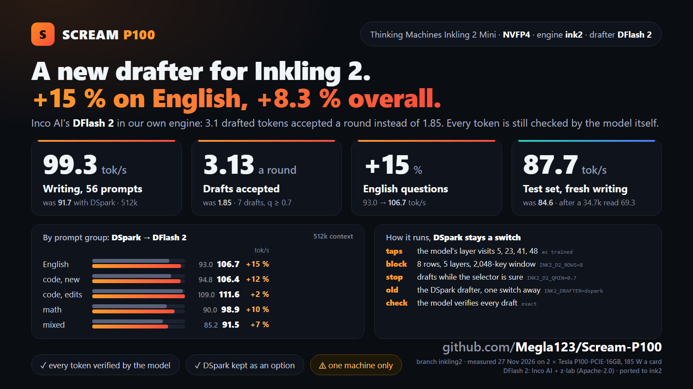
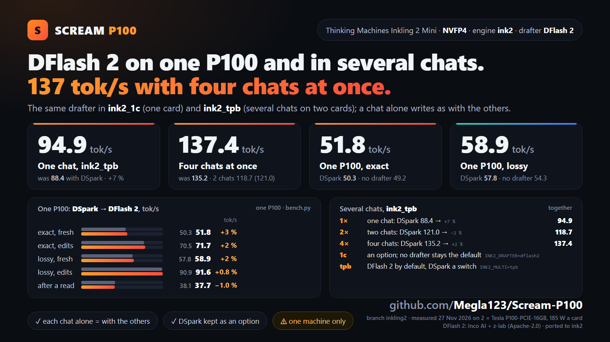
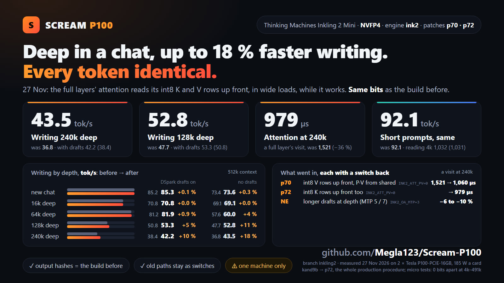
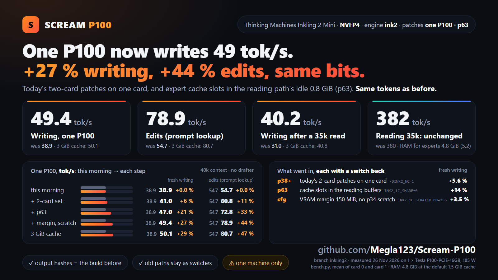
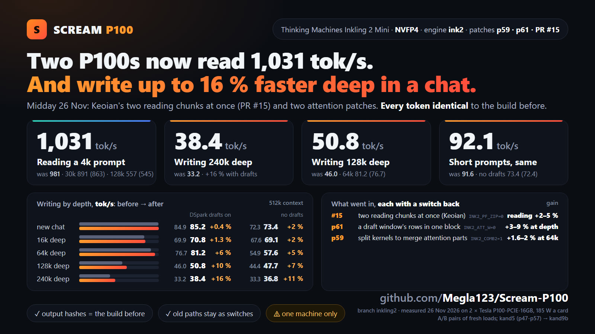
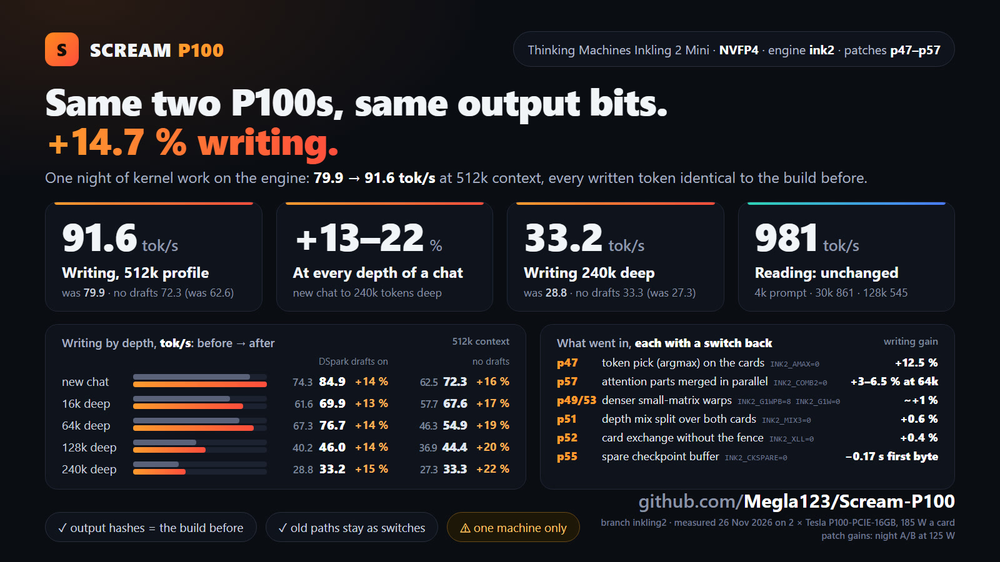

# Scream P100 · Inkling 2: an engine of its own for Inkling 2 Mini on two Tesla P100

> ⚠️ Built and measured on **one machine** (2× Tesla P100 16 GB, each on its own PCIe 3.0 x16 link, 99 GiB RAM), written on
> 21-22 Nov 2026. Nobody else has run it yet. Reports are welcome.

**Options:** a context of **256k** (the KV cache all in f16) or **512k** (the long part of the KV cache in int8, the first 32k
tokens exactly as at 256k, the same speed), and **pictures** (the model's vision projector on the CPU) in both. **Reading
30-37 % faster since 22 Nov** (p19, [below](#reading-faster-p19)): 790 tok/s on a 37.6k prompt at 256k or 512k, was 578.
**A conversation keeps its place** (22 Nov evening, p21-p23, [below](#conversations-keep-their-place-p21-p23)): a chat's next
turn reads only its new messages (first byte after 0.76 s instead of ~20 s on a 16k conversation), a conversation that
another one pushed off the cards comes back from RAM in under a second, writing is 10 % faster without drafts and 2 % with
them, and code in a prompt is tokenized as written. **Short pieces 18-22 % faster** (23 Nov, p25-p27,
[below](#short-pieces-read-faster-p25-p27)): a chat turn's 64 or 128 new tokens are read in 251 / 336 ms instead of 322 /
409, the experts of the last 4 layers no longer go through f32 copies. **One P100 too** (23 Nov, `ink2_1c`,
[below](#one-p100-ink2_1c-23-nov)): `INK2_CARDS=1`, the most used experts in VRAM and the rest in RAM with an on-card cache,
40 tok/s fresh writing exactly (45/45 functions, as two cards) within 8 GB of RAM, or 48 tok/s within 6 GB with the lossy
`INK2_LOSSY=1`. **Several chats at once** (24 Nov, two test builds, [below](#several-conversations-at-once-ink2_tpb-ink2_pp-24-nov)):
`INK2_MULTI=tpb` writes for up to 4 agents together, 121 / 134 / 136 tok/s in all for 2 / 3 / 4 instead of ~85 one after another,
while a single chat stays bit for bit `ink2_v1`; `INK2_MULTI=pp`, a pipeline with half of the layers on each card, reaches
148 tok/s with 4 and 162-166 with 6. Every conversation's output is the same alone and beside the others. **Reading 3 % faster
on every load** (24 Nov, p38-p41, [below](#two-cards-on-the-one-card-sources-the-exchange-by-numa-node-p38-p41-24-nov)): the
reading exchange's page-locked buffers now sit on the NUMA node of the card that writes them (946 → 980 tok/s on 4k prompts,
828 → 851 on 30k; before, it depended on where the loading thread ran), and writing with drafts after a 30k prompt is 1.7 %
faster; the same bits. **Writing 15 % faster** (26 Nov, p47-p57,
[below](#writing-faster-the-argmax-on-the-cards-and-less-waiting-p47-p57-26-nov)): each card now picks the next token
itself instead of sending 0.4 MB of logits a row to the host, and several smaller waits are gone: on 56 prompts at 512k 79.9 →
91.6 tok/s with drafts and 62.6 → 72.4 without, up to 22 % faster at a depth of 240k tokens, edits 139 → 171 tok/s; the same
bits, reading as before. **And reading 5 % faster, writing at depth up to 16 %** (26 Nov, p59, p61 and Keoian's PR #15,
[below](#attention-at-depth-and-two-reading-chunks-at-once-p59-p61-pr-15-26-nov)): two reading chunks at once (1,031 tok/s at
4k, was 981), the attention's parts joined by more blocks and a draft window's rows in one block (240k: 33.2 → 38.4 tok/s with
drafts); the same bits. **A second drafter, DFlash 2** (27 Nov, p74, [below](#dflash-2-a-second-drafter-8--faster-writing-p74-27-nov)):
Inco AI's and z-lab's block drafter writes 8.3 % faster than DSpark on our 56 prompts (91.7 → 99.3 tok/s) and 15 % faster in
English (93.0 → 106.7); `run.sh` uses it by default, `INK2_DRAFTER=dspark` keeps DSpark; it runs on one card and in
`INK2_MULTI=tpb` too. **A budget for the reasoning** (27 Nov, p75, [below](#a-budget-for-the-reasoning-p75-27-nov)): a
reasoning that runs past its effort's budget is closed at a sentence end and the model answers; under it the output is the
same bit for bit.

Thinking Machines' **Inkling 2 Mini** (26.4B MoE: 24 layers, layers 6-17 run three times for 48 passes, 128 experts of which 8
per token, a 1,024-token window on most layers, one full-attention layer in six, NVFP4 experts) on the same two P100s as
Scream P100's Flash-Next, with an **engine of its own**, `ink2` (`engine-inkling2/`): Strata's split engine does not know the
looped layers, the depth mixing, the loop controllers and messages, the short convolutions, the relative position bias with
a sink logit, or the DSpark drafter, so we wrote one with the same idea. **`ink2` is not a Strata fork:** its engine, kernels,
GGUF reader and server are written for Inkling 2 and hold no Strata code; it links llama.cpp only for the tokenizer and
the picture encoder. **Both cards work on every layer at once**, and
here the **whole model sits in VRAM** (8.9 GB a card): no RAM tier, no PCIe streaming of experts.

## Speed

Same two P100 16 GB, temperature 0, everything exact (f32 sums, only their order differs from llama.cpp's).

| | llama.cpp `690b87d` (same cards, layer split) | **ink2** |
|---|---|---|
| Fresh writing, no drafts | 13.0 tok/s | **56.6** |
| Fresh writing, DSpark (MTP) 3 + prompt lookup | — | **78.8** (code, 256 tokens) |
| Edits (the model repeats a file with a change) | — | **100.7** (700 tokens) |
| Reading a 4,096 / 14,336 / 40,960-token prompt | 143 / 119 / — | **~965 / 917 / 798** (at CTX 256k or 512k; ~940 / 887 / 776 before p25) |
| VRAM a card | 14.0-14.5 GB | 8.9 GB writing only, 11.8 GB with the drafter at 32k |
| Context | 32k measured | **262,144** (KV f16) or **524,288** (KV int8 past 32k), 15.2 GiB a card with the drafter |
| Pictures | mmproj (on a card) | mmproj on the CPU, ~20 s for a 1600×900 picture (920 rows), then read at ~640 tok/s |

(The writing rows are from 21-23 Nov. Since 26 Nov, p47-p57, writing is ~15 % faster with the same output: 72.4 tok/s
without drafts and 91.6 with them on 56 prompts at 512k, see [below](#writing-faster-the-argmax-on-the-cards-and-less-waiting-p47-p57-26-nov).)

On the **test set of our Flash-Next builds** (the same prompts, through the OpenAI API, `INK2` with its defaults), against
Scream P100's Flash-Next UD-Q4_K_XL on the same machine (ink2 on 26 Nov with p47-p57 at 185 W a card, Flash-Next on 22 Nov,
at the context each option runs with):

| Test | **ink2, 256k (exact)** | **ink2, 512k** | Flash-Next Q4_K_XL, exact | Flash-Next Q4_K_XL, fast (lossy) |
|---|---|---|---|---|
| Fresh writing (12 prompts, thinking low) | **81.4** | **81.4** | 59.3 | 68.9 |
| Edits, Python / Markdown ¹ | **170.6 / 167.6** | **170.5 / 167.5** | 100.9 / 92.2 | 124.3 / 125.6 |
| Koda's 26 edit tasks (tool calls, hidden tests; 22 Nov) | **97.4** tok/s, 24/26 right | — | — | — |
| Reading 37.6k / writing after it | **796** / 66.1 | **797** / 64.7 | 802 / 61.8 | 987 / 51.3 |

(22 Nov, before p47-p57 and before the server's low reasoning effort: 67.3 / 75.3 / 114.3 / 790 / 53.2 at 256k. The build of
24 Nov gives 71.4 / 139.1 / 136.8 / 793 / 58.3 in the same run as the 256k column, see
[below](#writing-faster-the-argmax-on-the-cards-and-less-waiting-p47-p57-26-nov).)

¹ Inkling thinks before it answers even at effort 0, and both of these prompts are 1,600 / 1,396 tokens of reasoning (in the
Python one the file has no variable of the name it is asked to rename), so they time its reasoning, not copying, and follow
the text: with p19's reading path the sums of the prompt come out in another order, the greedy reasoning takes another turn,
and the two numbers went from 115.5 / 127.8 to 75.3 / 114.3, while the same build with every p19 switch off gives the old
numbers exactly (`INK2_PF_QSF=64 INK2_SHARE=0 INK2_GEMM5=0 INK2_XSPLIT=1`: 115.2 / 127.4); with the low reasoning effort of 23
Nov the reasoning is another text again. On Koda's 26 edit tasks the speed was the same before and after p19 (97.3 / 97.4
tok/s). Writing after the long read differs between 256k and 512k for the same reason (the int8 rows past 32k change the
answer a little). Long reads are bound by f32 arithmetic: the P100 has no
tensor cores, and Flash-Next's fast numbers use f16 there.

**Long context:** a word hidden in the first line of a **239,114-token** prompt was found at 256k (read in 876 s, 273 tok/s on
average, writing after it at 42.2 tok/s with the drafter), and of a **496,073-token** prompt at 512k (read in 3,041 s, 163
tok/s on average, writing after it at 24.2). The f16 KV cache costs 16 KB a token on each card, so 256k is the most that fits
in f16 with the drafter; see [256k or 512k](#256k-or-512k) for how 512k fits. 1M tokens (the model's limit) cannot fit even
in int8 (8.5 GiB of KV a card).

**Quality** (21 Nov, before p19; p19 in [Reading faster](#reading-faster-p19)): greedy outputs of 32 tokens on English, Slovenian and code prompts are the same as llama.cpp's; KL of the last
row 0.0001 / 0.025 / 0.00001; on a 4k prompt the first token is the same in 13 of the last 16 rows (in the other three the
top two swap places, KL 0.0000-0.040, 0.014 on average; llama.cpp quantizes its own inputs to q8_1). On the task sets of our
Flash-Next builds, through the server with its defaults: **44 of 45** functions with hidden tests (Flash-Next UD-Q4_K_XL 45),
written at 85.6 tok/s (73.6); English questions **16/16** (16); Slovenian questions 12/15, the same three missed by llama.cpp
on the same file (two authors of Slovenian classics
and one clock sum missed); 0 of 18 Klepet-style answers in Croatian or Serbian, 0 of 6 open Slovenian prompts with foreign
words. Inkling reasons before it answers even at the lowest effort, and once spent a whole 1,200-token answer on it.

## Run it

```bash
git clone -b inkling2 https://github.com/Megla123/Scream-P100.git && cd Scream-P100
bash engine-inkling2/build.sh                 # ink2_v1 (nvcc); ink2_vis, ink2_tok + llama.cpp's llama-tokenize on the CPU
bash engine-inkling2/setup.sh /data/inkling2  # the model (17.6 GB), the drafters (DFlash 2 0.99 GB, DSpark 0.4 GB), the projector (0.64 GB), a venv
bash engine-inkling2/run.sh /data/inkling2 256k   # or 512k; OpenAI-compatible API on http://127.0.0.1:8080/v1
```

`run.sh DATA [CTX] [PORT]`: CTX `256k` (= 262144), `512k` (= 524288) or any number up to 524288 (default 32768); pictures are
on when DATA holds the projector (`setup.sh DATA --no-pictures` leaves it out, `INK2_PICTURES=0` turns them off). The log
(the engine's and the server's lines) goes to the terminal and, each line with its time, to `DATA/ink2-PORT.log`, appended
(`INK2_LOG=FILE` for another file, `INK2_LOG=0` for none); its first lines name the context, the port and the commit.
`python3 engine-inkling2/tools/bench.py` measures fresh writing, an edit and a long read through the API,
`python3 engine-inkling2/tools/picture_check.py` sends a picture (by default this branch's card picture) and asks for its title,
`python3 engine-inkling2/tools/conversation_check.py` runs a chat with a long system message and a tool the way a chat app
sends it and says how many tokens each request read.
`GET /metrics` answers in Prometheus' text format with llama-server's names (24 Nov, issue #10): counters since the start,
summed from every request's `timings`: `llamacpp:prompt_tokens_total` (prompt tokens read, not the ones from the conversation
cache), `llamacpp:prompt_seconds_total`, `llamacpp:prompt_tokens_cached_total` (from checkpoints and parked conversations),
`llamacpp:tokens_predicted_total`, `llamacpp:tokens_predicted_seconds_total`, `llamacpp:n_drafted_total`,
`llamacpp:n_drafted_accepted_total`, and the gauge `llamacpp:requests_processing`.
`GET /slots` gives `id_task`, the request's number (24 Nov), so a client that watches the slot tells back-to-back requests
apart (without it, our node counted 5-8 short requests in a row as one request of 12-18 s).
Checked from a clean clone of this branch on our machine (22 Nov, CUDA 12.4, `HOST_CXX=g++-13`): `build.sh` in 3.5 min
(llama.cpp downloaded and built anew), `setup.sh`, then for each option `run.sh`, `tools/picture_check.py` and `tools/bench.py`;
in the morning with the pictures and the 512k option, at noon again with p19's faster reading (the same clone, `build.sh`
again in 46 s):

| | `run.sh DATA 256k` | `run.sh DATA 512k` |
|---|---|---|
| Ready, VRAM a card | 48 s, 15.19 GiB → **14.76** (p19) | 48 s, 15.24 GiB |
| Picture: the title | read word for word (30.6 s with the encoding, 952-token prompt in 1.5 s → **1.2 s**) | the same, 30.9 s |
| Fresh writing | 70.4 tok/s (p19: 70.4) | 70.4 (70.5) |
| The edit | 77.8 tok/s (p19: 87.8) | 77.8 (88.0) |
| 34,699-token read / writing after it | 594.9 / 58.7 → **789.6** / 57.3 tok/s | 600.3 / 59.1 → **800.0** / 58.5 |

The edit test repeats `serve/ink2_server.py`, which grew with the pictures (21 → 26 KB) and makes Inkling reason first, so
its number follows the text of that reasoning (its 21 Nov copy gave 99.1 tok/s on the morning's engine at 256k, 105.9 on 21
Nov at CTX 65536). On 21 Nov at CTX 65536: fresh 70.8, a 34,699-token read at 684.8. If your default g++ is newer than CUDA
12.4 accepts, set `HOST_CXX=g++-13`.

Files: Xylolabs's [`Inkling-2-Mini-NVFP4-Q8_0.gguf`](https://huggingface.co/Xylolabs/Inkling-2-Mini-GGUF) (the original
NVFP4 experts with a scale per expert, the last four layers Q8_0, the rest Q8_0 / F32) and Unsloth's
[`dspark-Inkling-2-Mini-Q8_0.gguf`](https://huggingface.co/unsloth/Inkling-2-Mini-GGUF), the model's own MTP drafter, and
Xylolabs's `mmproj-Inkling-2-Mini-BF16.gguf` (same repository as the model), its vision projector. The
model is Thinking Machines' [Inkling 2 Mini](https://huggingface.co/thinkingmachines/Inkling-2-Mini); its license applies to
the weights. Both GGUFs were renamed on Hugging Face on 22-23 Nov (the same bytes): the model is `Inkling-2-Mini-NVFP4-Lite.gguf`
there now and the drafter `dspark-Inkling-2-Mini-Q8_0_Old.gguf` (today's `dspark-Inkling-2-Mini-Q8_0.gguf` is another file, which
this engine was not checked with). `setup.sh` downloads them by those names and keeps the first names in DATA.

The server (`serve/ink2_server.py`) answers `/v1/chat/completions` (streamed or not; the thinking part as
`reasoning_content`), `/v1/models`, `/health`, `/props`, `/slots`, `/tokenize` and `/apply-template`, so llama-server
clients work. `reasoning_effort` (none … xhigh) sets Inkling's "Thinking effort level". **Tool calls** work: OpenAI `tools` go in
as the template's `tool_declare`, the model's calls come back as `tool_calls` (streamed too), tool results as its tool messages;
the prompt equals the GGUF template's to the character (`tools/template_check.py`), and a web search tool in a chat app and a
coding agent's write / bash tools worked on our machine. **Pictures**: `image_url` parts (a data URL, an http(s) URL or a
local path; checked with one picture a message). Limits: **greedy only** (no sampler yet), one request at a time (the [test builds for several chats](#several-conversations-at-once-ink2_tpb-ink2_pp-24-nov) take more). A follow-up turn of a
conversation reads only the new part, and so does a prompt that parts from the conversation earlier or comes back after
another one ([checkpoints and parked conversations](#conversations-keep-their-place-p21-p23)).

## DFlash 2: a second drafter, 8 % faster writing (p74, 27 Nov)

[](#dflash-2-a-second-drafter-8--faster-writing-p74-27-nov)

`src/` (`build/ink2_v1`) now has **a second drafter**: [DFlash 2](https://huggingface.co/incoai/Inkling-2-Mini-DFlash2) by
Inco AI and z-lab (Apache-2.0), made for Inkling 2 Mini. On English questions it writes **15 % faster** than DSpark (106.7 tok/s
instead of 93.0 at 512k, 185 W a card), on code functions 12 %, on arithmetic 10 %, and on all our prompts 8.3 % (99.3 instead
of 91.7). No kind of prompt got slower. Deep in a chat it is about as fast as DSpark. `run.sh` uses it by default. **DSpark
stays a choice:** `INK2_DRAFTER=dspark`.

DFlash 2 drafts a whole block in one pass: the anchor and 7 mask tokens through 5 layers, with a two-tap dynamic convolution
before and after each attention and feed-forward. The model's own head gives 16 candidates at each of the 7 positions. Then a
small selector (two codebooks of rank 256) scores each pair of neighbouring candidates and walks one path. The last checked
token and the drafts become a window that the model checks as before, so **every written token is still the model's own**.

How it runs here:
- **Two cards.** It runs whole on both cards, like DSpark (the same inputs give the same bits). Each card's half of the head
  gives a top-16 there, two passes of 32 parts. The host merges both lists and walks the selector. A draft needs only the row of
  the predecessor the walk took: 16 dot products of 256. One sync a round (DSpark: one per draft).
- **Context.** Its context is the same four features as DSpark's: the inputs of layer visits 5, 23 and 41 and the final normed
  hidden. They go through `fc` and a norm into each layer's K/V, kept in rings of 2,560 rows (its window is 2,048).
  - Checkpoints and parked conversations keep the rings' last 2,048 rows.
  - Reading a long prompt, only the rows the rings keep are projected.
- **Its own GEMV for 8 rows.** The target's kernels are built for single tokens and bit-exact windows. At 8 rows they read the
  input once a warp from L2: ~107 µs for a 6912 × 2304 matrix. `k_d2_gemv2` takes a row a thread and 32 bytes a step, with the
  input once a block in shared memory: 93 µs. The head and `fc` use `k_d2_gemv`, 4 rows a warp: 1.28 ms instead of 1.99 for
  7 rows of the head. All of them are bound by instructions at 8 rows, not by memory. A round of the drafter takes ~4.7 ms
  (DSpark ~2.4).
- **The four things Inkling needs.** zzzprojectpage/inkling2-p100-dflash2 found them: without them DFlash 2 accepts almost
  nothing on Inkling. All four are here:
  1. the tap ids as in the checkpoint (5, 23, 41, 48);
  2. the real vocabulary of 200,058 (the codebooks are cut, the top-16 is over real tokens only);
  3. Inkling's embedding norm on the anchor's and the mask's rows;
  4. the selector's soft cap after its correction (`selector_softcap_mode: after_correction`).
- **Sources.** The arithmetic follows SGLang's `DFlash2DraftModel` with the checkpoint's Inkling patch, and llama.cpp's
  `dflash` / `dflash2` graphs. A PyTorch reference of it judged both drafters on the model's own greedy answers before the port.
- **Getting it.** `setup.sh` fetches the checkpoint (0.99 GB, BF16). At its first start `run.sh` makes the engine's GGUF with
  `tools/dflash2_gguf.py` (0.62 GB: the matrices Q8_0, the codebooks BF16; only numpy and llama.cpp's gguf-py).
  - `--mtp` takes either drafter's file; a DFlash 2 GGUF has `dflash.selector_rank`.
- **Switches.**
  - `INK2_D2_QMIN` (0.7): a draft stops below this probability of the selector's softmax over its 16 candidates.
  - `INK2_D2_ROWS` (8): the block's rows, as trained. 4 rows were 11 % worse.
  - With DFlash 2, `run.sh` sets the server's `INK2_OA_MTP` to 7 drafts.

Writing, 56 prompts (greedy, at most 600 tokens, prompt lookup 15, 512k, 185 W a card), tok/s and drafts accepted a round:

| prompts | DSpark, 3 drafts | DFlash 2, 5 drafts | **DFlash 2, 7 drafts** |
|---|---|---|---|
| English questions | 93.0 (1.75) | 105.8 | **106.7** (3.37) |
| arithmetic | 90.0 (1.66) | 98.1 | **98.9** (3.04) |
| code, functions | 94.8 (1.89) | 103.7 | **106.4** (3.56) |
| code, edits | 109.0 (3.07) | 110.8 | **111.6** (4.12) |
| new topics | 80.0 (1.32) | 84.7 | **84.5** (2.20) |
| older tests | 85.2 (1.54) | 90.8 | **91.5** (2.65) |
| **all** | **91.7** (1.85) | 98.3 (2.81) | **99.3** (3.13) |

DFlash 2 at a gate of 0.5: 94.7 / 97.9 / 95.5 tok/s with 3 / 5 / 7 drafts. At 0.7: 93.6 / 98.3 / 99.3.

At depth (our docs and sources cut to each depth and a question, 256 tokens), tok/s:

| depth | DSpark, 3 drafts | DFlash 2, 3 drafts | DFlash 2, 7 drafts | no drafts |
|---:|---|---|---|---|
| 16k | 70.6 | 67.2 | 68.4 | 68.7 |
| 64k | 82.0 | 79.6 | 77.5 | 59.3 |
| 128k | 53.2 | 54.2 | 53.7 | 52.3 |
| 240k | 42.3 | 41.6 | 41.0 | 43.2 |

At depth it accepts more drafts than DSpark but pays for its bigger block, and its window of 2,048 keys sees less of the
chat than DSpark's 12k layer.

Through the server (`tools/bench.py`, 512k, the drafter at 7 drafts against the build before with DSpark at 3): fresh writing
84.6 → **87.7** tok/s, an edit 155.5 → 156.0, reading 34.7k tokens 828 → 832, writing after it 67.6 → **69.3**.

**The same model, slightly different texts.** Every draft is checked, but which tokens are checked together changes the order of a few
sums in a window. Near a tie between two tokens that can pick the other one. So any drafter writes texts that differ from
writing without drafts at some point, and two drafters differ from each other:

| | the same of 56 |
|---|---|
| DSpark against no drafts | 33 |
| DFlash 2 against no drafts | 33 |
| DFlash 2 against DSpark | 34-38 |

Without drafts the engine is bit for bit as before with DFlash 2 loaded: the 56 answers, the reads' logits (4k / 30k / 128k),
checkpoints and parked conversations.

[](#dflash-2-a-second-drafter-8--faster-writing-p74-27-nov)

**One P100** (`build/ink2_1c`, the same sources with `-DINK2_NC=1`): DFlash 2 runs there too, and it is a little faster than
DSpark everywhere. Against writing without a drafter it gains on fresh text but loses on edits. So the one-card build still
runs **without a drafter by default**, and `INK2_DRAFTER=dflash2` turns it on. The drafter's 0.58 GB of VRAM moves experts to
RAM, and a rejected draft costs their transfers. Measured with `tools/bench.py` at CTX 40960 and 185 W, in tok/s:

| one P100 | fresh | edit | read 34.7k | writing after it |
|---|---|---|---|---|
| exact, no drafter | 49.2 | **78.8** | 380 | **40.0** |
| exact, DSpark, 3 drafts | 50.3 | 70.5 | 383 | 38.1 |
| exact, DFlash 2, 7 drafts | **51.8** | 71.7 | 383 | 37.7 |
| lossy (`INK2_LOSSY=1`), no drafter | 54.3 | **95.0** | 398 | 45.0 |
| lossy, DSpark, 3 drafts | 57.8 | 90.9 | 394 | **47.1** |
| lossy, DFlash 2, 7 drafts | **58.9** | 91.6 | 402 | 44.5 |

**Several conversations at once** (`ink2_tpb`, `src-tpb/`): DFlash 2 runs there too, with its own rings in each conversation's
slot (52 MB a card). Each conversation writes the same tokens alone and beside the others. It is the default there as well
(`INK2_MULTI=tpb`). Fresh writing, 256 tokens a conversation, 4 slots of 24576, all conversations together, tok/s:

| conversations at once | no drafts | DSpark, 3 drafts | DFlash 2, 7 drafts |
|---:|---|---|---|
| 1 | 61.5 | 88.4 | **94.9** |
| 2 | 88.3 | **121.0** | 118.7 |
| 4 | 102.5 | 135.2 | **137.4** |

Alone, English writes 94.6 instead of 82.2 and code 107.0 instead of 98.1. With 2 or 4 conversations the two drafters are about
the same. The pipeline build (`ink2_pp`) keeps DSpark: its drafter sits on card 1 and its head on card 0.

Tried and left out:
- **The head on the 32k draft vocabulary** (DSpark's way): the head would be 6 times cheaper, but 11 % fewer drafts were
  accepted (17 % in English).
- **4 rows of x a thread in the GEMV** (`k_d2_gemv3`): slower than `k_d2_gemv2`.
- **A block of 4 rows** instead of 8: 11 % fewer drafts accepted.
- **The next step** would be the drafter's block split over the two cards instead of whole on each (half the GEMVs, ~4
  exchanges a layer).

## A budget for the reasoning (p75, 27 Nov)

`serve/ink2_server.py` now gives each answer's reasoning a **budget by its effort**. When a reasoning reaches it, the server waits for
the end of its sentence (at most 512 tokens more) and closes it with a short note: "I have thought about this long enough and I
have what I need, so I stop thinking here and write the answer now." Then the model writes its answer or its tool call. It works the
same way as the loop guard closes a reasoning that repeats itself. An answer whose reasoning stays under its budget is **the same,
bit for bit**, as before.

| effort | none, minimal | low | medium | high | xhigh, max |
|---|---|---|---|---|---|
| budget (tokens) | 1,024 | 4,096 | 8,192 | 16,384 | 32,768 |

A request with tools (an agent's step) gets at most 8,192 (`INK2_THINK_BUDGET_TOOLS`).

Why these numbers:
- In our agent's sessions all Inkling steps ran at high, and 99 % of their reasonings were under ~2,700 tokens. One ran 53,000
  characters (~13k tokens) into the length limit and gave neither an answer nor a call.
- A hard reasoning task at high took 9,200 tokens and was right, so high keeps 16k.
- A request at 125k of context that once enumerated 33,768 characters of reasoning without an answer now answers (20,239
  characters).

Checked against the server before it, on the same engine:
- a 125k-token request with 7,441 characters of reasoning and four short requests (low, medium, high, one with a tool) gave the
  same output bit for bit;
- with a budget of 300 the reasoning was closed at 319 tokens at a sentence end, and the answer that followed was right.

The budget is in the server, so it works the same on one card and with several conversations at once (`INK2_MULTI`, whose
server `make_multi.py` makes from this file). We checked both with a budget of 300 on a question that needs a longer reasoning:
- one card: the reasoning was closed at 349 tokens and the answer was right;
- `INK2_MULTI=tpb` with two conversations at once: both were closed at 355 tokens and gave the same right answer.

`INK2_THINK_BUDGET` sets the five budgets (comma list); `INK2_THINK_BUDGET=0` turns it off.

## Attention at depth: the int8 rows up front (p70, p72, 27 Nov)

[](#attention-at-depth-the-int8-rows-up-front-p70-p72-27-nov)

`src/` (`build/ink2_v1`) now writes **up to 18 % faster at a depth of 240k tokens** (43.5 tok/s without drafts, 42.2 with
them; it was 36.8 and 38.4) and 11 % / 5 % faster at 128k, again with **the same output**. The 56 prompts' answers with and
without drafts are those of the build before, and so are the reads' tokens and logits (4k / 30k / 128k) and every step's
logits hashed with drafts at 512k. Short prompts and reading are unchanged.

Deep in a chat, most of a written token's time goes to the full layers' attention: eight visits a token (layer 5, layers 11
and 17 three times each through the loop, layer 23). In the 512k option the KV rows past 32k are int8. The writing path read
a part's K in 16-byte pieces round by round, and its V one or two bytes a thread a key, in key order: one visit at 240k took
1,521 µs, about 190 GB/s of the card's ~500. Now, for a part whose rows are int8:

- **p70:** the part's V rows (16-byte pieces) and their scales are issued at the kernel's start, so they arrive while the K
  part runs. They wait in registers, go into shared memory after the K part, and P·V reads them from there. The values, the
  products and their order (a thread a dimension, the keys in order) are the same.
- **p72:** the K pieces of all the part's rounds are issued at the start too. The K loop, unrolled over its rounds, takes
  them from registers.
- The f16 parts (the first 32k rows) keep the old code, and so do parts of 128 keys with 2 rows a block (past 256k): staging
  was slower there.
- `INK2_ATT_PV` (1) switches both; 0 = the old kernels.

One visit of a full layer, µs. These are micro tests against the kernels of the build before (cold L2, median of 21, both
cards), 0 bits apart everywhere; old and new numbers come from runs a few minutes apart:

| depth | 1 row (no drafts) | window of 2 rows | window of 4 rows |
|---:|---|---|---|
| 65k | 429 → 333 | 542 → 477 | 937 → 829 |
| 131k | 819 → 564 | 1,037 → 852 | 1,738 → 1,516 |
| 240k | 1,521 → 979 | 1,975 → 1,530 | 3,273 → 2,767 |
| 491k | 2,898 → 1,728 | 3,669 → 3,711 | 6,853 → 5,929 |

Writing at depth, tok/s (our docs and sources cut to each depth and a question, 256 tokens, 512k, 185 W a card; the build
before was measured the day before with the same procedure):

| depth | DSpark drafts on | no drafts |
|---:|---|---|
| new chat | 85.2 → 85.3 | 73.4 → 73.6 |
| 16k | 70.8 → 70.8 | 69.1 → 69.1 |
| 64k | 81.2 → 81.9 | 57.6 → 60.0 |
| 128k | 50.8 → 53.3 | 47.7 → 52.8 |
| 240k | 38.4 → 42.2 | 36.8 → 43.5 |

Tried the same morning and left out:
- **Longer drafts at depth.** MTP 5 and 7, with n-grams 15 or 31, were 6-10 % slower than MTP 3 at 128k and 240k. On this
  text a round accepts only 1.3-1.6 drafts there, and a window's rows cost more. n-grams 31 changed nothing, and at 240k
  writing without drafts was 2 % faster than MTP 3.
- **The window's queries read as float4** (the rows padded to 20 floats): the same bits, but 1-3 % slower.

## One P100: 27 % faster writing, the same bits (26 Nov evening)

`build/ink2_1c` is now built from `src/`, the two-card engine's sources with `-DINK2_NC=1 -DINK2_RING=2048` (they kept every
one-card path), so today's exact patches (p38-p41, p47-p57, p59, p61) are in the [one-card build](#one-p100-ink2_1c-23-nov)
too; PR #15's two reading chunks switch themselves off on one card. On top of them, and on in `run.sh` with `INK2_CARDS=1`:

- **p63, cache slots also in the reading path's buffers** (`INK2_1C_SHARE=1`; 0 = the old cache). With one card the reading
  path keeps 877 MiB (a chunk's rows, the experts' inputs and outputs, the attention's pieces, the staging of RAM experts)
  that the writing path never touches. 0.79 GiB of slots of the experts' size are cut out of them and given to the layers by
  the cache's own weights, after each layer's slots in the cache's block. Before a prompt is read, only those slots are emptied
  (their experts' tables point to RAM again); the cache's own slots keep their experts. On our writing traces the bytes over
  PCIe a token went from 51.6 to 25.0 MB.
- **No p34 scratch** (`INK2_1C_SCRATCH_MB=0`; the engine's default stays 256): with the bigger cache a pick seldom finds no free
  slot; such an expert is then read over PCIe straight from RAM (the same sums), and the 256 MiB go to the experts in VRAM.

Speed on one card (185 W, `tools/bench.py` through the API at CTX 40960, no drafter, plan `data/plan_1c.txt`; each number is
the mean of the same run on card 0 and on card 1 of our machine, run side by side, each under `numactl` on its own node):

| | fresh writing | the edit | 34,701-token read / writing after it | RAM for experts |
|---|---|---|---|---|
| the build of 23 Nov (VRAM margin 400 MiB) | 38.9 | 54.7 | 380 / 31.0 | 5.24 GiB |
| + today's two-card patches | 41.1 | 60.8 | 381 / 33.5 | 5.24 GiB |
| + p63 | 47.0 | 72.8 | 380 / 38.2 | 5.24 GiB |
| **+ margin 150 MiB, no scratch (`run.sh` now)** | **49.4** | **78.9** | 382 / **40.2** | **4.75 GiB** |
| the same with `INK2_1C_CACHE_MB=3072` | 50.1 | 80.7 | 376 / 40.8 | 6.25 GiB |
| (lossy) the same with `INK2_LOSSY=1`, 3072 | 54.6 | 95.1 | 391 / 45.1 | 4.35 GiB |

The edit test here repeats the `serve/ink2_server.py` of a clone of 23 Nov, so compare its numbers only inside this table.
Every written token and every step's logits are the same as the 23 Nov build's (`p38_ab.py`, with drafts: the kodachat prompt
and 256 tokens, the first 30,000 tokens of a long text and 256 after them, all logits hashed), at a cache of 1536 and of 3072.
With drafts (MTP 3 + n-grams 15) the 30k text writes 29.7 → 39.1 tok/s.

Tried the same evening and left out:
- the cache split by the layers' missed counts: on the writing traces, with the engine's real static set, worse than the
  split by the plan's weights (81.6 against 74.2 MB a token);
- the copy into the cache on a second stream beside gate_up of the experts already on the card (the same bits): 9 % slower;
- a ring of 3072 rows (reading chunks of 2,048 tokens): reading 34.7k +16 % (430 tok/s), writing 2-5 % slower; a choice for
  long prompts, not the default;
- the drafter on one card: fresh writing +3-5 %, the edit 10-14 % slower, so it stays off;
- binding the server to the other NUMA node or to none: no difference;
- (lossy) the RAM experts as 2-bit copies (the cache's slots 44 % smaller): no faster, since the last 4 layers' Q8 experts
  carry most misses, and the edit broke (78.8 → 50.8: the model no longer copied the file exactly) although the KL of short
  prompts stayed small (en 1.6e-3, code 5.5e-6).

[](#one-p100-27--faster-writing-the-same-bits-26-nov-evening)

## Attention at depth and two reading chunks at once (p59, p61, PR #15, 26 Nov)

[](#attention-at-depth-and-two-reading-chunks-at-once-p59-p61-pr-15-26-nov)

`src/` (`build/ink2_v1`) now writes up to **16 % faster at a depth of 240k tokens** and reads **5 % faster** (over 1,000
tok/s at 4k for the first time on our machine), again with **the same output**: every answer of the 56 prompts below, every
read's tokens and logits, and every step's logits hashed with drafts at 512k are those of p47-p57 (and of p41). Three changes,
each with a switch whose old value runs the old code:

- **p59, the attention's parts joined by more blocks** (`INK2_COMB2=3`, from `INK2_COMB4_MIN` = 48 parts; `1` = p57's
  kernel). After p57 one block of 128 threads a (row, head) still waited for each part's values one after the other: 137 µs
  at 1,024 parts (64k) whether a window had 1, 2 or 4 rows, so the limit was the block, not the 6.4 MB it reads. For one or
  two rows it is now 4 blocks of 32 threads a head (each block finds the same maximum and weights itself, a thread still one
  dimension), the values 32 parts ahead in registers, and the head's rotation and gate in a small kernel after it; for 3 or
  more rows one block with the values 16 parts ahead. The same sums in the same order. Alone (micro test, a card): 137 → 46
  µs at 1,024 parts, 497 → 154 at 4,096.
- **p61, a draft window's rows in one block** (`INK2_ATT_W=1`, full-attention layers from `INK2_ATT_W_MIN` = 64 parts, that
  is 4k; `0` = one block a row). A window checks up to 4 drafted tokens at once, and on the full layers each of its rows read
  the part's K and V rows itself: `k_attn_dec` took 410 / 672 / 1,194 µs at 64k for 1 / 2 / 4 rows. Now 2 or 4 rows share a
  block and read them once (each row's dot products, softmax and sums the same code in the same order; the queries come from
  shared memory): 2 rows 669 → 502 µs, 4 rows 1,195 → 865, and at 240k 5,031 → 3,332. Below 4k it was 0.3 % slower on a short
  chat, hence the threshold. Single tokens are not touched.
- **[PR #15](https://github.com/Megla123/Scream-P100/pull/15) by Keoian, two reading chunks at once**
  ([above](#two-reading-chunks-at-once-ink2_pf_zip-25-26-nov-a-contribution-measured-on-two-other-machines)), **on by default
  in this build** (`INK2_PF_ZIP=2`; `0` = one chunk at a time). On our machine, two x16 links at 185 W, it fits at 512k (its 252
  MiB a card of the 292 to spare beside the experts, 15.25 GiB a card in use) and gives the same bits.

Each change alone, at 512k, 185 W, two runs of each arm, every token and hash the same:

| | before | after | |
|---|---|---|---|
| p59: writing at 64k, drafts / single tokens | 58.9 / 55.5 tok/s | 60.1 / 57.5 | +2.0 / +3.5 % |
| p59: writing at 128k, drafts / single tokens | 56.4 / 44.9 | 57.7 / 47.7 | +2.4 / +6.2 % |
| p61: writing with drafts at 64k / 128k | 60.2 / 57.8 | 62.2 / 63.1 | +3.4 / **+9.1 %** |
| PR #15: reading 4k / 30k / 128k from token 0 | 981 / 863 / 545 | **1,031** / 895 / 557 | +5.1 / +3.7 / +2.2 % |

All three against the build before (p47-p57), the whole check we run before a build goes into use (512k, 185 W):

| | p47-p57 | **+ p59, p61, PR #15** |
|---|---|---|
| Writing with drafts / without, the 56 prompts of the section below (all answers the same) | 91.6 / 72.4 tok/s | 92.1 / 73.4 |
| Writing at a depth of 0 / 16k / 64k / 128k / 240k tokens, with drafts | 84.9 / 69.9 / 76.7 / 46.0 / 33.2 | 85.2 / 70.8 / **81.2 / 50.8 / 38.4** (+5.9 / +10.4 / +15.7 % from 64k) |
| &nbsp; the same without drafts | 72.3 / 67.6 / 54.9 / 44.4 / 33.3 | 73.4 / 69.1 / 57.6 / 47.7 / 36.8 |
| Reading 4k / 30k / 128k from token 0 | 981 / 861 / 545 | **1,031** / 891 / 557 |
| Reading at a depth of 64k / 128k / 240k | 718 / 547 / 366 | 739 / 558 / 371 |
| `tools/bench.py` through the server: fresh / edit / 34.7k read / writing after it | 83.2 / 141.3 / 696 / 63.8 (the night before, 125 W: reading is slower there) | 84.6 / 155.4 / **824.5** / 68.0 |

Checkpoints (`ckpt_test`), parked conversations (`park_test`), a picture, a chat app's conversation and `/metrics` passed as
before. The micro tests and our step scripts are not in this branch; the numbers are from the engine through its socket.

## Writing faster: the argmax on the cards and less waiting (p47-p57, 26 Nov)

[](#writing-faster-the-argmax-on-the-cards-and-less-waiting-p47-p57-26-nov)

`src/` (`build/ink2_v1`) writes **15 % faster** with drafts and without them, and up to 22 % faster deep into a long context,
with **the same output as before**: on the 56 prompts below every answer is the same text, reads of 4k / 30k / 128k tokens
give the same tokens and logits, and with every step's logits hashed (drafts on, 512k) the hashes are p41's. A build of this
branch from a clean copy of `src/` gives the same outputs as the build we run (the binaries differ only in the name of a
temporary file nvcc writes into them). The drafter is the same official DSpark drafter; nothing in it changed.

Each change has a switch of its own, on by default; a switch at its old value runs the old code. They all give the same bits,
so they choose speed only: `INK2_AMAX=0 INK2_G1WPB=8 INK2_MIX3=0 INK2_XLL=0 INK2_G1W=0 INK2_CKSPARE=0 INK2_COMB2=0` is the
build of 24 Nov (p41) again.

| | What it does | Switch (default; old) | Measured alone (125 W; 256k profile, 32k context unless said) |
|---|---|---|---|
| p47 | Each card finds the largest logit of its rows itself (the first of equals, as the host did) and sends back only the value and its index. Before, every row of a draft window copied its 0.4 MB of logits a card to the host, which searched 200k values. The logits still come back for `lhall` tests, the first token after a prompt and `--logits`. | `INK2_AMAX` (1; 0) | **+12.5 %** with drafts, +9.8 % with prompt lookup only |
| p49 | The dense Q8 matrices of a single token in blocks of 2 warps instead of 8 (more, smaller blocks for 56 SMs; each row's sum the same code in the same order). | `INK2_G1WPB` (2; 8) | +0.1 % / +1.0 % |
| p51 | The depth mixes of a few rows in two launches over 24 + 9 blocks instead of one block a row. | `INK2_MIX3` (1; 0) | +0.6 % / +1.5 % |
| p52 | A single token's exchanges between the cards as 8-byte words, the value and a sequence number together (the idea of NCCL's LL protocol): the reader waits for the words themselves, so the writer needs no fence and no flag. Draft windows keep the flag. | `INK2_XLL` (1; 0) | +0.4 % / +2.3 % |
| p53 | The dense Q8 matrices of a single token with 4 rows a warp and every part of a row's columns in the same warp, summed in the order of the old last block, without partial sums in global memory. | `INK2_G1W` (4; 0) | 0 / +0.65 % |
| p55 | A new checkpoint needs a page-locked buffer of ~166 MiB a card. `cudaHostAlloc` made it before the first token until all of them existed (147 at 512k), so a new conversation waited 0.17 s for it; the spare buffer is now made between requests. | `INK2_CKSPARE` (1; 0) | a 59-token chat turn read in 0.25 s instead of 0.42; 6k-18k prompts 3-6.5 % sooner to the first token |
| p57 | A full-attention layer splits its keys into parts of 64, and one block a head joined them one after the other: the largest of their maxima, then each part's weight and the two sums. The block now finds the maximum together and each part's weight once (the same `expf` of the same value) in shared memory; the sums run in the same order. | `INK2_COMB2` (1; 0) | at 64k +6.5 % without drafts, +4.0 % with them; short prompts the same |

Also in the code, off by default: p43, a request field `"featdump": "/path"` that reads a prompt and writes the drafter's
four input features of every row to a file (for training drafters; nothing changes without it), and p50, `INK2_G6`, 64-token
expert tiles of 8 × 8 values a thread on the reading path (exact, but 3.5 % slower). After p47 the host no longer holds the
cards up: a trace of writing single tokens shows both cards busy 94 % of the time, so what is left is the kernels' own time.

Before and after on our machine, **185 W a card**, 26 Nov, the same runs one after the other in one window (p41 = the build of
24 Nov, in use until the morning of 26 Nov). Through the engine's socket at production's 512k unless said:

| | p41 | **p47-p57** |
|---|---|---|
| Writing with drafts (DSpark MTP 3 + prompt lookup 15), 56 prompts | 79.9 tok/s | **91.6** (+14.7 %) |
| &nbsp; English questions / arithmetic / writing code / editing code / Slovenian (8 prompts each) | 81.1 / 78.6 / 82.5 / 93.8 / 79.9 | 93.0 / 89.9 / 94.8 / **109.0** / 91.6 |
| Writing without drafts, the same 56 prompts | 62.6 | **72.4** (+15.6 %) |
| Writing at a depth of 0 / 16k / 64k / 128k / 240k tokens, with drafts | 74.3 / 61.6 / 67.3 / 40.2 / 28.8 | **84.9 / 69.9 / 76.7 / 46.0 / 33.2** (+13.5 to +15.3 %) |
| &nbsp; the same without drafts | 62.5 / 57.7 / 46.3 / 36.9 / 27.3 | **72.3 / 67.6 / 54.9 / 44.4 / 33.3** (+15.7 to +22.0 %) |
| Reading 4k / 30k / 128k tokens from token 0 | 981.6 / 856.2 / 544.9 | 981.4 / 860.6 / 544.6 (the same) |
| The test set of our Flash-Next builds through the server at 256k (`ab.py`): fresh writing / edits, Python / Markdown | 71.4 / 139.1 / 136.8 | **81.4 / 170.6 / 167.6** (+14 / +23 / +23 %) |
| &nbsp; the same: reading a 37.6k prompt / writing after it | 792.6 / 58.3 | 796.3 / **66.1** |
| The writing test's 14 requests at 256k (`pis_ab.py`): single tokens / with drafts | 62.3 / 84.3 | **72.2 / 97.2** (+15.9 / +15.4 %) |

Where a test keeps the answers (the 56 prompts, the 14 requests, the reads) both builds gave the same tokens in every one.
The 56 prompts are 8 of each kind: English questions, arithmetic, writing functions, editing code, two sets of prompts from
our drafter's tests and Slovenian; greedy, at most 600 tokens. A depth is a prompt of code and documents of that length and one question, 256 tokens written; reading at depth was
the same for both (924 / 718 / 546 / 366 tok/s at 16k / 64k / 128k / 240k). At 125 W the 56 prompts gave 79.0 → 90.0 with
drafts: writing hardly depends on the power limit, reading does (4k / 30k / 128k at 857 / 740 / 467).

## Two reading chunks at once (`INK2_PF_ZIP`, 25-26 Nov; a contribution, measured on two other machines)

> ⚠️ Not from the machine the rest of this file is measured on, but from two others. **A:** 2 × Tesla P100 16 GB, card 0 on
> PCIe 3.0 x16 and card 1 on a x4 link behind the chipset, an i7-7700 (4 cores), 48 GB of RAM, one NUMA node, CUDA 12.4 with
> g++ 11, driver 580.159.03; everything below is from A unless it says B. **B** ([below](#a-second-machine-x8--x16-two-sockets)):
> 2 × Tesla P100 at 150 W, card 0 on x8 (node 0) and card 1 on x16 (node 1), 2 × Xeon E5-2696 v3, 125 GB, CUDA 12.8 with
> g++ 14. Not run on two x16 links or above 150 W. Off by default: without the switch `build/ink2_v1` is the build before.

`INK2_PF_ZIP=2` reads two consecutive chunks (2,048 tokens each) at once. Each card still has one stream; the two chunks'
steps take turns on it, and a step ends where an exchange between the cards starts. So a chunk's exchange (18.9 MB each way,
96 a chunk) crosses PCIe while the other chunk computes, instead of both cards waiting for it. Here, with card 1 on a x4 link, that
takes 0.36 s off the 2.82 s of a chunk at 16k.

- **The same bits.** Each chunk's launches and cuBLAS calls are `pf_card`'s, with the same sizes and in the same order
  (`layer_pf` in three parts: up to the attention's exchange, from its sum to the experts' exchange, from that sum to the
  layer's end). The second chunk's layer k runs after the first chunk's layer k, which is what its cache rows and convolution
  states need. The chunks are cut as before, so nothing depends on the switch but the time.
- **VRAM: 252 MiB a card.** The second chunk has its own copies of what lives across an exchange: the hidden state and its
  four depth-mix states, the loop's three saved states and its fourth message, the exchanged rows and the drafter's
  features (14 × a chunk's rows). Everything else is scratch within a step, and the other card's part of either chunk's
  exchange comes back into the one buffer there was, ordered right after the sum before it. The engine prints what was to
  spare beside the experts (804 MiB at 256k, 292 at 512k here, so 40 are left at 512k). **When it does not fit, the switch turns itself off** and
  says so, so no expert goes to RAM for it (checked before the buffers are taken and again after, since the driver rounds
  allocations up).
- **Its exchange buffers** (two of 18 MiB a card, page-locked) are placed by `INK2_NUMA` like p41's. On B (two nodes) they
  landed where each setting says, and the three settings read within 0.4 % of each other.
- The chunks of a read go in pairs from its start and an odd last one goes alone; a piece below 2,048 + `INK2_PF_MIN`
  tokens is one chunk and reads as before.

The engine alone (`--tokens`, the drafter loaded, 32 tokens written after the prompt), reading in tok/s. In every row the
last row's logits and the written tokens with the switch are the same files as 1aa0abe's build gives (`cmp`), and so are
this build's without the switch at 256k:

| Prompt | without the switch | `INK2_PF_ZIP=2` | |
|---|---|---|---|
| 5,003 tokens, 256k | 749.5 (this build) | **838.6** | +12 % |
| 16,384 tokens, 256k | 726.2 (this build), 729.5 (1aa0abe) | **832.9** | +15 % |
| 36,000 tokens, 256k | 661.7 (this build) | **750.8** | +13 % |
| 36,000 tokens, 512k | 655.8 (1aa0abe) | **744.2** | +13 % |
| 60,000 tokens, 512k (int8 rows from 32,768 on) | 589.9 (1aa0abe) | **661.4** | +12 % |

Writing after the prompts is the same (57.9 / 57.5 tok/s after 16k, 53.0 / 53.1 after 36k). (This table is from an
earlier build of the branch, with 270 MiB a card: before the guard's second look, the two error cases left to the loop, and
the one buffer for the other card's part. The battery and `bench.py` below are from the final build, where reading came
out 1-2 % faster still.)

**Every step's logits.** The engine's socket with `"lhall": 1`, drafts on (MTP 3, lookup 15), a fixed number of written
tokens, every arm a freshly loaded engine. The requests: 16 prompts read from token 0 with lengths around a chunk's edges
(31, 500, 2,047, 2,048, 2,078, 2,079, 2,100, 2,304, 4,095, 4,096, 4,097, 4,126, 4,127, 6,399, 8,192 and 10,000 tokens), a
20k conversation with checkpoints, its next turn, a prompt that parts at one of its checkpoints, another conversation, the
first one back from RAM, and a 36k prompt (a 60k one at 512k); with and without the switch also a 200k one. Compared: `lh`, `lh2`, the written tokens, the drafted /
accepted counts and the checkpoint a request went back to.

| Arm | the same as 1aa0abe's build | reads of 4k to 36k tokens, tok/s |
|---|---|---|
| this build, no switch | 21 of 21 | 691.5 (1aa0abe: 688.2) |
| `INK2_PF_ZIP=2` | 23 of 23 | **780.7** |
| `INK2_PF_ZIP=2` while six busy loops load the CPU (other timing) | 21 of 21 | 790.0 |
| `INK2_PF_ZIP=3` (the four longest edges and the conversations) | 9 of 9 | 787.6 |
| `INK2_PF_CHUNK=1024`, both builds | 9 of 9 | 643.8 → 698.2 |
| `INK2_XSPLIT=2`, both builds | 9 of 9 | 661.7 → 771.1 |
| 512k, both builds, with the 60k prompt | 10 of 10 | 630.9 → 719.2 |

The 200,000-token prompt (256k): 355.7 → 380.5 tok/s, the same hashes.

Writing in these arms is the same within 1 % (68.6 tok/s over 1aa0abe's requests). A prompt whose second chunk
does not fit the context (`--ctx 4000`, 4,090 tokens) ends in "context full" in both builds, and the request after it gives
the same `lh` and `lh2`.

Through the server (the earlier build), the switch off and on, each arm the same requests on a freshly started server (so that every read
starts from the same state in both arms). Text, reasoning and the drafter's counts (drafted / accepted) were the same in
all nine:

- A 19,961-token prompt, its next turn (20 tokens read), a 12,815-token prompt, a 12-token one, and two with a picture
  (after 3k tokens of text, where its rows fall into the second chunk, and before 6k). Reading 684.9 → 790.6, 700.2 →
  805.5, 714.9 → 823.4 (the picture after the text) and 701.4 → 767.3 tok/s.
- Reads that start from a checkpoint: a chat with a 7.4k-token system message (11,965 tokens read), a new chat with the same
  system message (back to its end, 6,796 read) and the first chat's next turn with a long message (11,245 read from 7,434).
  Reading 699.6 → 794.9, 681.6 → 772.8 and 652.8 → 735.6 tok/s.
- `tools/bench.py` (256k), this build without the switch → with it, each on a freshly started server: fresh 74.9 → 74.9,
  edit 78.4 → 78.4, the 34,701-token read **639.6 → 733.6**, writing after it 65.4 → 65.3 tok/s (1aa0abe's build on the same
  morning: 74.3, 78.6, 644.3, 64.6).

While a 36.7k-token prompt is read with the switch on, card 1 (the x4 one) is busy 100 % of the time and card 0 94 %
(`nvidia-smi`, 0.5 s samples; measured before the buffers' last trim, 324 MiB then): reading is bound by card 1's compute,
no longer by the link.

### A second machine: x8 + x16, two sockets

B: 2 × Tesla P100 16 GB capped at 150 W (77-79 °C at most), card 0 on PCIe 3.0 x8 on node 0, card 1 on x16 on node 1, 2 ×
Xeon E5-2696 v3 (36 cores), 125 GB, CUDA 12.8, g++ 14 (`HOST_CXX=g++-14`), driver 580.178.04. Both builds from clean clones
with `build.sh` (1aa0abe and this branch), the files from `setup.sh` on a box that did not have them. One load an arm.

- **Bits:** the same battery as above, against 1aa0abe's build: no switch 21 of 21, `INK2_PF_ZIP=2` 22 of 22 and again 21 of
  21, `INK2_PF_ZIP=3` 9 of 9, `INK2_NUMA=0` and `=2` with the switch 9 of 9 each, 512k without the switch 21 of 21 and with it
  22 of 22 (with a 60k prompt). Every hash the same.
- **Reading, request by request:** with the switch 3.4-5.5 % faster than 1aa0abe at 256k (the 36k read 725.4 → 755.5 tok/s) and
  3.5-8.0 % at 512k (the 60k read 634.6 → 662.4). Without the switch at 512k within 0.5 % of 1aa0abe; at 256k it read
  1.6-2.5 % slower in the battery, but it ran second, on cards up to 5 °C warmer and 15-18 MHz slower than 1aa0abe's arm, and
  through the server (below, each from cool cards) the two are the same.
- **`tools/bench.py`** (256k, each on a freshly started server, cards at or below 60 °C):

  | | 1aa0abe | this build, no switch | `INK2_PF_ZIP=2` |
  |---|---|---|---|
  | fresh | 81.6 | 81.5 | 81.6 |
  | edit | 85.1 | 85.2 | 85.1 |
  | the 34,701-token read | 709.5 | 711.3 | **753.0** (+6.1 %) |
  | writing after it | 69.7 | 69.9 | 70.2 |

- **Why less than on A:** while a 44k prompt is read without the switch, card 0 (x8) is busy 99 % of the time and card 1 (x16)
  96 %, at 100 % in only 19 % of the samples: card 1 waits for the exchanges. With the switch both are busy 99 % (card 1 at
  100 % in 98 % of the samples), 671.6 → 710.6 tok/s. The exchange was a shorter wait on x8 / x16 than on A's x4.
- **VRAM:** 800 MiB to spare beside the experts at 256k, 288 at 512k (36 left with the switch); no expert in RAM in any arm.
- **The exchange buffers by node:** `INK2_NUMA=1` put card 0's on node 0 and card 1's on node 1, `=0` both cards' on node 0,
  `=2` each on the other card's node, as the engine's lines say; the reads: 801.5, 803.0 and 804.4 tok/s (short set).

**Tried and left out** (same bits each, measured on an experimental build that is not in this branch):

- `INK2_PF_ZIP=3` (it is in: three chunks at once, 504 MiB a card): 787.6 tok/s against 780.7 with two in the battery. Nothing left to hide with a third chunk, and at 512k it does not fit.
- The experts by token slices, each slice's exchange under the next slice's experts: four equal slices 679.8 tok/s at 16k
  against 717.4 (smaller tiles), two 715.0, slices of 85 / 10 / 5 % 735.5 (+2.5 %) and 668.8 against 664.7 at 36k.
- The attention's out projection and its exchange a slice as soon as its query blocks are done: 718.5 at 16k (one block a
  chunk there), 661.0 against 664.7 at 36k.

**Not run:** two x16 links, and anything above 150 W on B (the gain should be smaller there than B's 4-8 %, by how B's x16 card
waited; not measured); one card and `INK2_XSPLIT=1` (the switch says that it is off there); a second load of each arm on B;
`src-1c/`, `src-tpb/` and `src-pp/` are untouched.

## Two cards on the one-card sources, the exchange by NUMA node (p38-p41, 24 Nov)

`src/` (`build/ink2_v1`) is now the one-card build's code ([below](#one-p100-ink2_1c-23-nov), p30-p36: every expert in a block
of its own, the kernels take the experts through a table of addresses) built for two cards, with four changes on top. The
output is the same bits as p27's: every token and every step's logits hashed, with drafts, at 256k and 512k.

- **p38, a draft window's attention rows side by side:** `k_attn_dec` ran a window's rows one after another in the grid's z;
  they now sit next to each other in x, so the blocks that read the same KV rows run together and share L2. Writing with
  drafts after a 30k prompt 63.2 → 64.3 tok/s, short prompts the same. `INK2_ATT_ROWS=0` turns it off.
- **p39, every expert on the cards:** the one-card placement kept 1 GiB for its cache of RAM experts and 256 MiB of scratch even
  when everything fits, which with two cards at 512k pushed 2.42 GiB of experts to RAM. When every expert fits there is now
  no cache and no scratch, and two cards keep a 150 MiB margin (one card 400): 7.36 GiB of experts a card in VRAM at 256k and
  512k, 15.00 GiB of a card in use at 512k (p27: 15.24).
- **p40:** the placement is printed a card (the two cards place their experts at once).
- **p41, the reading exchange's buffers on the writer's node:** our server has two sockets and a card on each
  (`nvidia-smi topo -m`: GPU0 on NUMA node 0, GPU1 on node 1). On the reading path each card copies its part of every
  exchange to a page-locked buffer of its own (two of 18 MiB, by parity) and the other card copies it from there. The pages
  landed on the node of the thread that allocated them, wherever the scheduler had put it, so reading changed from one load to
  the next. The same build, only the buffers moved:

  | Where the two cards' buffers were | 4 × 4,096-token prompts | 2 × 30,000-token prompts |
  |---|---|---|
  | both on node 1 | 949 tok/s | 828 |
  | both on node 0 | 962 | 840 |
  | each on the other card's node (`INK2_NUMA=2`) | 977 | 847 |
  | **each on its own card's node (`INK2_NUMA=1`, default)** | **980 / 984 / 981** (three loads) | **851 / 851 / 851** |

  p27 read at 947 / 828 on 3 of 5 loads (one thread allocated both cards' buffers). The one-card sources built for two cards
  had looked 3-4 % faster at reading than p27: their two loading threads, one a card, often put each card's buffers on its
  own node. p41 allocates them from a thread bound to that card's node (`/sys/bus/pci/devices/<card>/numa_node`, the node's
  CPUs for the allocation only); `INK2_NUMA=0` leaves it to the scheduler as before. The engine prints where they landed:

  ```
  ink2_v1: kartica 0 (vozlisce 0): medpomnilnika izmenjave branja na vozliscu 0 0 (INK2_NUMA 1)
  ink2_v1: kartica 1 (vozlisce 1): medpomnilnika izmenjave branja na vozliscu 1 1 (INK2_NUMA 1)
  ```

  A machine with one socket, or with both cards on one node, gets nothing from it and loses nothing.

Before and after on our machine (512k, the drafter loaded, 24 Nov; p27 on its usual load):

| | p27 | **p41** |
|---|---|---|
| Reading 4 × 4,096 / 2 × 30,000-token prompts | 947 / 828 tok/s | **981 / 851** |
| Writing after them (no drafts, 32 / 64 tokens) | 60.6 / 54.4 | 60.7 / 54.5 |
| Writing with drafts (MTP 3 + lookup): code, 256 tokens / after a 30k prompt | 78.0 / 63.2 | 78.3 / **64.3** |
| `tools/bench.py` through the server: fresh / edit / 34.7k read / writing after it | 73.5 / 77.2 / 797 / 57.6 | 73.8 / 78.0 / **807** / 58.4 |

(`bench.py`'s edit was 88.1 tok/s on 23 Nov, before the server's reasoning effort went to low by default: p27 gives 77.2 on
the same server now. In that run p27's buffers were both on node 0, the middle row above.) The one-card build stays on
`src-1c/` as it was measured; p38-p41 have not been run on one card.

## Several conversations at once (`ink2_tpb`, `ink2_pp`, 24 Nov)

> ⚠️ Two **test builds**, measured on one machine. No pictures, no checkpoints or parked conversations.

With `ink2_v1` the server writes for one request at a time. A second chat or agent waits until the first answer is done, so
the two cards give ~85 tok/s whatever the number of agents. These two builds write for several conversations at once.

Each conversation has a **slot** of its own on the cards: its KV cache, the convolutions' states and the drafter's rings.
**Its output does not depend on the others.** Alone or beside 1-3 others, a conversation gets the same tokens and the same
logits at every step. We checked this on every stage of the work, with every step's logits hashed.

### `ink2_tpb`: production's layout with slots

`src-tpb/`, run with `INK2_MULTI=tpb`. Both cards work on every layer, as in `ink2_v1`, plus slots and **batches**:

- **Batches.** The writing pieces of up to 4 conversations go through one forward:
  - the parts every row shares (the dense matrices, the experts, the loop controllers, the head) run once for all rows;
  - the parts that read a conversation's own state (attention, the short convolutions) run group by group, with the rows
    that conversation would have alone, so no sum changes.
- **Gathering.** One thread drives both cards, and a piece waits up to 5 ms for others to join it.
- **Interleaved reading.** A reading chunk (2,048 tokens) goes in 8 parts, with the waiting writers' pieces between them, so
  a long prompt does not stall the other chats.
- **Alone it is bit for bit `ink2_v1`**, at the same speed: the same logits on our four reference prompts (English,
  Slovenian, code, a 4k text).

### `ink2_pp`: a pipeline over the two cards

`src-pp/`, run with `INK2_MULTI=pp`. Half of the model sits on each card, with the one-card kernels of `ink2_1c`:

- **Split.** Card 0 holds layers 0-5 and 12-17 and the head. Card 1 holds layers 6-11 and 18-23, the DSpark drafter and the
  final mix.
- **Segments.** Layers 6-17 run three times, so each card has 24 of the 48 passes. A token goes through 8 segments of
  6 passes that alternate between the cards, then the head.
- **Overlap.** Each card has its own thread and queue of segments. While card 1 works for one conversation, card 0 works
  for another. Segments of several conversations go through together as a batch.
- **Hand-off.** The hidden state crosses between the cards through page-locked RAM (no P2P on our machine).
- **Speed.** One conversation alone uses one card at a time and is slower; four to six keep both cards busy.
- **Exactness.** Not bit for bit `ink2_v1`: other kernels sum in another order. KL against it is 9·10⁻¹⁰ on a short
  prompt and 5·10⁻³ on a 4k text, where the first token differs (a near tie).

### Speed with several chats

Measured on the engine's socket: every conversation a different prompt, 256 fresh tokens each, greedy. The numbers are the
sum of the conversations' writing speeds, what the two cards write in a second. "With drafts" is MTP 3 + lookup 15, the
server's default.

| At once | `ink2_v1`, with drafts / without | **`ink2_tpb`** | **`ink2_pp`** |
|---|---|---|---|
| 1 | 88 / 63 | **86** / 62 | 61 / 50 |
| 2 | ~85 / 63 (the second waits) | **121** / 90 | 108 / 96 |
| 3 | ~85 / 63 | **134** / 99 | |
| 4 | ~85 / 63 | 136 / 104 | **148** / 119 |
| 6 (6 slots of 32k) | | (does not fit) | **162-166** / 133 |

- **Each conversation is slower, the cards write more.** With `ink2_tpb`, a conversation writes 86, 60.5, 44.5 and
  34 tok/s with 1-4 at once, but the cards write 40-60 % more in all.
- **Reading** a 4k / 30k prompt:

  | | 4k | 30k | writing after the 30k read |
  |---|---|---|---|
  | `ink2_tpb` | 987 | 856 | 54.5 |
  | `ink2_pp` | 953-958 | 837 | 42.6 |
  | `ink2_v1` | 956 | 836 | 54.9 |

- **A long read beside writers.** One conversation read 12k while three others wrote. With `ink2_tpb` the writers' first
  token came after 0.6-1.3 s, against 4.5-6.8 s without the interleaving. All four ended about as before (21.1 against
  21.6 s).

**Which build:** `ink2_tpb` for 1-3 agents, where a single chat loses nothing against `ink2_v1`; `ink2_pp` for four and
more (with two they are close).

**Slots:**

- `ink2_tpb`: a slot takes 1.0 GiB a card at 24k and 1.47 GiB at 40k, so 4 × 24k or 3 × 40k fit.
- `ink2_pp`: 4 × 64k or 6 × 32k.

A request takes the free slot that already holds the longest part of its prompt (its last turn, or the snapshot before the
last answer), or else the one used least recently.

**Follow-up turns.** A request that continues its slot's tokens exactly (an agent's tool round) reads only what is new. A
chat app that sends the previous answer without its reasoning, as most do, makes the next turn read the whole prompt again,
because these builds do not have p21's checkpoints yet (see the clean-clone check below).

```bash
INK2_MULTI=tpb bash engine-inkling2/run.sh /data/inkling2                   # 4 slots of 24576
INK2_MULTI=tpb INK2_SLOTS=3 bash engine-inkling2/run.sh /data/inkling2 40960
INK2_MULTI=pp bash engine-inkling2/run.sh /data/inkling2                    # 4 slots of 65536
INK2_MULTI=pp INK2_SLOTS=6 bash engine-inkling2/run.sh /data/inkling2 32768
python3 engine-inkling2/tools/multi_bench.py http://127.0.0.1:8080 1,2,4    # speed at once, and alone = together
```

At every start `run.sh` makes `build/ink2_server_multi.py` from `serve/ink2_server.py` (`serve/make_multi.py`: a semaphore
of `--slots` instead of the lock). Up to `INK2_SLOTS` requests run at once; more wait. Limits of the test builds:

- no pictures (a request with one gets an error);
- no checkpoints or parked conversations: a conversation lives only in its slot;
- the context is per slot.

**Switches** (named in our notes' Slovenian):

| Switch | Default | What |
|---|---|---|
| `INK2_PP_PAKET` | 4 | conversations in a batch; 1 = no batches |
| `INK2_PP_ZBIRAJ_MS` | 5 | `ink2_tpb`: how long a piece waits for others |
| `INK2_PP_PREPLETI` | 1 | `ink2_tpb`: the interleaved reading |
| `INK2_PP_SPIN_MS` | 80 / 20 | how long a thread spins before it sleeps (`ink2_tpb` / `ink2_pp`) |
| `INK2_PP_DELITEV` | `il` | `ink2_pp` only; `12` = layers 0-11 / 12-23 |
| `INK2_PP_GLAVA` | 0 | `ink2_pp` only; 1 = the head split by halves of the vocabulary |
| `INK2_PP_RISAR` | 1 | `ink2_pp` only: the drafter and final mix on card 1 |
| `INK2_PP_INFLIGHT` | 2 | `ink2_pp` only: chunks of one prompt in the pipe |
| `INK2_PF_CHUNK` | 1024 | `ink2_pp` only (the reading chunk here) |

**What did not help** (all exact):

- the drafter's Markov chain on the card instead of one transfer a step (the drafter is only ~7 % of a round);
- CUDA events instead of waiting at the hand-offs: 119 → 104 tok/s, because the threads fill a card's queue and a hand-off
  waits behind it;
- `INK2_FUSE2=15`;
- `INK2_PERM=1`;
- 3-4 chunks of a prompt in the pipe;
- MTP 4 (MTP 2 ≈ MTP 3);
- other draft confidence limits.

A reading chunk of 2,048 in the pipeline (`-DINK2_RING=4096`) reads 1.5-6 % faster, but with other bits.

**Checked from a clean clone** of this branch on our machine (24 Nov, CUDA 12.4, `HOST_CXX=g++-13`, default slots). The
sources are byte for byte the ones measured above, and `build.sh` took 4 min (now also `build/ink2_tpb` and `build/ink2_pp`).

| | `INK2_MULTI=tpb` (4 × 24k) | `INK2_MULTI=pp` (4 × 64k) | `INK2_MULTI=pp INK2_SLOTS=6` (6 × 32k) |
|---|---|---|---|
| Alone against `build/ink2_v1` (CLI, 32 tokens) | **bit for bit** on English, Slovenian, code, a 4k text | KL 9·10⁻¹⁰ (English), 5·10⁻³ (4k text); the clone's build = the measured one bit for bit | |
| Ready | 48 s | 50 s | 52 s |
| `tools/multi_bench.py`, tok/s in all, 1 / 2 / 3 / 4 / 6 at once | 69.0 / 85.6 / 92.0 / **110.0** | 51.5 / 87.4 / - / **123.7** | 52.5 / - / - / - / **133.8** |
| The same answers alone and together | yes | yes | yes |
| `tools/conversation_check.py` (a 13k chat with a tool) | tool round 0.65 s to the first byte; the next turns read all 13k again: 13.9 s | tool round 1.1 s; the next turns 14.4 s | |

`multi_bench.py`'s prompts draft less well than the ones in the speed table (alone 55-86 tok/s with `ink2_tpb`), so its
totals are lower. The gain from more conversations is the same:

- `ink2_tpb`: ×1.6 with 4;
- `ink2_pp`: ×2.4 with 4 and ×2.5 with 6.

[](#several-conversations-at-once-ink2_tpb-ink2_pp-24-nov)

## One P100 (`ink2_1c`, 23 Nov)

**Since 26 Nov evening the one-card build is faster with the same bits; see
[One P100: 27 % faster writing](#one-p100-27--faster-writing-the-same-bits-26-nov-evening). This section describes how it
works and the numbers of 23 Nov.**

The same engine for **one Tesla P100 16 GB** and as little RAM as it takes: `build/ink2_1c` (from `src/` with `-DINK2_NC=1`
since 26 Nov, before from `src-1c/`; built by `build.sh`), run with `INK2_CARDS=1 bash engine-inkling2/run.sh DATA [CTX]`. The whole model does not fit on one card (experts
15.4 GiB, the rest ~3.5 GiB with a 32k context), so the experts that are used most stay in VRAM and the others wait in RAM:

- **Placement:** after everything else is on the card, the experts fill what is left in the order of `data/plan_1c.txt`
  (most used a byte first; made by `tools/plan_1c.py` from 5 × 30k tokens of reading and 5 × 400 written tokens, see its
  header). Routing is concentrated: in a layer, 64 of the 128 experts carry 70-90 % of the picks. The rest sit in page-locked
  RAM that the card can read; the kernels take every expert through a table of addresses.
- **Writing:** an on-card **cache of RAM experts** (1.5 GiB by default): after a layer's routing the card itself copies each
  picked RAM expert into the least recently used slot of that layer in one transfer, and the next passes of the loop and the
  next tokens find it there. Writing traces showed why: on written text a static choice of 11 GiB hits only 85 % of the picks
  (reading had promised 96 %), and an LRU cache of 1-1.5 GiB cut the bytes over PCIe by ~40 %.
- **Reading:** the RAM experts with rows in a chunk go to the card in groups through two staging buffers, copied while the
  group before is multiplied (each crosses PCIe once a chunk); chunks of 1,024 tokens and smaller scratch (the window layers'
  rings, the attention buffers) leave ~1.5 GiB more for experts.
- **No drafter** by default: on one card a rejected draft also costs its experts' transfers, and the drafter's VRAM is taken
  from the experts; with it writing was a few percent slower (fresh 37.8 against 40.0, the edit 37.2 against 41.0).
- **Lossy option `INK2_LOSSY=1`:** the last 4 layers' experts are Q8_0 in the file (the release's MXFP8, 8.46 MB an expert);
  this requantizes them at load to NVFP4 like the other 20 layers (4.48 MB: a scale an expert matrix, an E4M3 scale a 16
  values, E2M1 codes), so ~2 GB more of the model fits on the card. The output changes (KL against two cards 1e-5 to 2.5e-3
  on short prompts, 6.5e-3 on a 4k prompt; the exact one-card build: 1e-9 to 1e-11 on the short ones).

**Speed** (the same machine, one card, temperature 0, `bench.py` through the API at CTX 40960 inside a systemd scope with
`MemoryMax` and no swap, as on a PC with that much RAM; two cards for comparison):

| | One card, exact | One card, `INK2_LOSSY=1` | Lossy at CTX 65536 | Two cards |
|---|---|---|---|---|
| Fresh writing | **40.2** tok/s | **48.0** | 44.2 | 73.4 |
| The edit | 41.1 | 45.6 | 42.1 | 88.1 |
| 34,699-token read / writing after it | 378 / 33.5 | 396 / 38.7 | 403 / 35.9 | 792 / 58.9 |
| RAM limit / most used (engine, server, tokenizer) | 8 GB / **6.9 GiB** | 6 GB / **5.3 GiB** | 7 GB / 6.1 GiB | not limited (checkpoints and parked chats up to 24 + 32 GiB) |
| Experts in VRAM / RAM | 9.7 / 5.0 GiB | 9.7 / 3.1 GiB | 8.9 / 3.9 GiB | all in VRAM |
| Ready in | ~52 s | ~80 s (the requantizing) | ~80 s | ~48 s |

Writing 200 tokens after four prompts (CLI, CTX 32768): exact 35.9 / 38.5 / 45.4 / 39.4 tok/s (a 4k text, a chat, Slovenian,
code), lossy 44.9 / 48.0 / 49.4 / 48.3; a 4k prompt reads at ~500 tok/s (two cards: ~965). Reading is about half of two cards
(one card does all the work); writing reaches 55-65 % of two cards without drafts.

**Quality** (the shared sets of our Flash-Next builds, through the API, reasoning low):

| | functions with hidden tests | English | Slovenian questions | not in Slovenian / foreign words |
|---|---|---|---|---|
| One card, exact | **45/45** | 16/16 | 12/15 | 0/18, 0/6 |
| One card, lossy | 43/45 (`decode`, `lfu`) | 16/16 | 12/15 | 0/18, 0/6 |
| Two cards | 45/45 | 16/16 | 12/15 | 0/18, 0/6 |

The exact one-card build is the same math as two cards (only the order of the sums differs): on short prompts the same
tokens. 43 to 45 of 45 is the range we have seen between exact builds before (43 and 44 on 22 Nov).

**Context:** every 32k of context takes ~1 GiB of the card from the experts (65536 still runs well, above that writing slows).
The KV cache cannot go to RAM instead: every written token reads all of the full layers' rows (~32 KB a token of context),
while it needs only ~5 % of the experts. **RAM:** the RAM experts (3-5 GiB, page-locked), checkpoints of the conversation up
to 2048 MiB (`INK2_CKPT_MB`), no parked conversations (`INK2_PARK_MB`, 0 with one card); the model file is read once through
the page cache while loading. With the drafter 6 GB was too little.

Switches (environment of `run.sh`): `INK2_CARDS=1`, `INK2_LOSSY=1`, `CUDA_VISIBLE_DEVICES` (the card, default 0),
`INK2_1C_CACHE_MB` (the cache of RAM experts, 1536), `INK2_1C_MARGIN_MB` (VRAM left free, 150), `INK2_1C_PLAN` (the order),
`INK2_1C_EXP_MB` (at most this much for the static experts), `INK2_1C_STAGE_MB` (64, the reading path's two staging buffers),
`INK2_1C_SCRATCH_MB` (256 in the engine, 0 in `run.sh` since 26 Nov: a window's RAM experts beyond the cache),
`INK2_1C_SHARE` (0 in the engine, 1 in `run.sh` since 26 Nov: cache slots also in the reading path's buffers, p63),
`INK2_RTRACE=FILE` (the writing path's routing, for `tools/plan_1c.py`).

Checked from a clean clone of this branch on our machine (23 Nov, CUDA 12.4, `HOST_CXX=g++-13`, card 0): `build.sh` in 2 min
(now also `build/ink2_1c`), then `INK2_CARDS=1 run.sh DATA 40960` and the same with `INK2_LOSSY=1`:

| | `INK2_CARDS=1` | `INK2_CARDS=1 INK2_LOSSY=1` |
|---|---|---|
| Ready, experts in VRAM / RAM | 76 s, 9.71 / 5.00 GiB | 100 s, 9.72 / 3.10 GiB |
| Picture: the title | read word for word (952-token prompt in 2.7 s, writing 35.8 tok/s) | |
| `tools/conversation_check.py` (a 13k chat with a tool) | all OK; the next turns 1.2-1.5 s to the first byte, writing 36.6-37.2 | all OK; 0.9-1.3 s, 42.2-44.0 |
| `tools/bench.py`: fresh / edit / 34,699-token read / writing after it | 40.2 / 38.2 / 379.4 / 33.6 tok/s | 48.0 / 46.8 / 397.7 / 38.7 |

(The edit test repeats `serve/ink2_server.py`, which grew on 23 Nov, so its number is not comparable with the table above.)

[](#one-p100-ink2_1c-23-nov)

## Conversations keep their place (p21-p23)

22 Nov, evening. The kernels were not where a chat lost its time. The engine kept one snapshot, at the end of the last
prompt, and a request read its whole prompt again from token 0 in four everyday cases:

| What happened | Measured before | Why |
|---|---|---|
| Every turn of a chat in our app | first byte after 9.2 s; all ~7,200 tokens read each turn | the app moves a note about the environment from the previous user message to the new one, so the prompt parts from the conversation 13 tokens **before** the old prompt's end, where the snapshot stood |
| A client shortened its history | 54 s for 40.8k tokens | the same: it parted before the snapshot |
| Any answer over 3,056 tokens | 83 s for a 58k conversation, at every request after it | the snapshot was good only while the windows' ring (4,096 rows) had not been written over |
| Another conversation in between | everything read again | the cards hold one conversation |

And every request waited 0.9 s before reading at all: `llama-tokenize` started anew and read the vocabulary.

**Checkpoints in RAM.** A checkpoint is what it takes to go back to a place in the conversation: the convolutions' states,
the last 1,024 rows of every window slot's ring and the drafter's rings (278 MiB for both cards, page-locked RAM; the full
layers' rows stay where they are, they are kept by position). The server tells the engine where the prompt's messages
start; the engine takes a checkpoint at the last of them, at earlier ones 4,096 tokens apart, every 16,384 tokens of a long
read and before the prompt's last token. A request goes back to the latest checkpoint its prompt still shares. Taking one
costs 15-30 ms (~150 ms the first time a buffer is page-locked), going back 30 ms.
Since 24 Nov the answer's own head (the `<|message_model|>` two tokens before the prompt's end) is no longer such a start,
so the last one is the last message's: a new chat with the same long system part (a router's pick, a sub-agent) goes
back to its end and reads only its own message. Profile picks of ~1,585 tokens at 512k: 2.28 s -> 0.11-0.16 s, the
same answers, and the engine's RAM no longer grows by the parked conversation of every pick (17 -> 23 GB after ten
requests before, 17 -> 18 GB now).

**Parked conversations.** When a request shares less than half of the conversation on the cards, that conversation's full
layers' rows (32.8 KB a token for both cards, its int8 rows and scales in the 512k mode) go to RAM with its tokens and its
first and last three checkpoints. A later request that shares more with a parked conversation than with the one on the
cards gets its rows copied back: the whole conversation when the prompt goes on from its end, a copy up to a checkpoint
when it parts earlier (a new chat with the same system prompt and tools). RAM is taken as it is needed, up to
`INK2_CKPT_MB` (24576) for checkpoints and `INK2_PARK_MB` (32768) for parked conversations, the least recently used out
first: **set them lower on a machine with less RAM** (ours has 99 GiB).

**A tokenizer that stays up.** `build/ink2_tok` is llama.cpp's tokenizer with the same flags as `llama-tokenize --no-escape`,
as a process the server starts once. The prompt is cut where its messages' parts start (special tokens, so each piece
tokenizes by itself as in the whole) and the pieces' tokens are cached by their text: ~10 ms a request instead of ~900.
**And the text is now tokenized as written:** the server ran `llama-tokenize` without `--no-escape`, which turns a written
`\n`, `\t` or `\\` (two characters, as in source code) into the character itself, so code in a prompt reached the model with
broken string literals.

Through the server, a chat with a 16.2k-token system message and a tool, the note moving each turn
(`tools/conversation_check.py` does the same with a 13k one):

| Request | Read before | Read now | First byte now |
|---|---|---|---|
| The first turn | 16,226 tokens | 16,226 | 20.7 s |
| The tool's round | 16,654 | 429 | 1.6 s |
| The second turn | 16,281 | 106 | 0.76 s |
| The third turn | 16,347 | 184 | 0.86 s |
| The turn after a 1,340-token answer | 17,505 | 1,342 (that answer and the new message) | 2.2 s |

The answer before a turn is still read again: its user message changed (the note left it), and what was written after it is
no longer true to the prompt. A client that leaves its history as it was sends only its new message.

On the engine's socket (`--ctx 262144` and `524288`), each against the same prompt read from token 0 with the same hints.
The logits after the prompt (a hash of all of them), the tokens written and the drafts taken were **the same in every case**:

| Case | From token 0 | Now |
|---|---|---|
| The same 13.2k prompt after 3,500 written tokens | 15.7 s | 0.03 s |
| A prompt that parts 13 tokens before its end | 16.2 s | 1.0 s |
| A 38k prompt shortened to 31k with a new tail | 40.5 s | 2.2 s (drafts taken after it: 202 of 310, the same) |
| A 13.2k conversation back after another one | 15.6 s | 0.76 s |
| A 20k conversation back | 24.5 s | 0.46 s |
| A new chat that shares its first 13k tokens | 15.9 s | 1.9 s |
| A 38k conversation parked and back (int8 rows at 512k) | 51.5 s | 0.79 s (drafts 98 of 148, the same) |

**Writing: fewer launches, the same bits.** A token is 48 passes of 16 to 29 small kernel launches. `src/ink2_fuse.cuh` runs the
three loop controllers' down projections in one launch, their gains and forgets in another, the three inputs' norms in one
and their Q8 matrices in one; every block does what it did before. Against the launches before (`INK2_FUSE2=0`), on 14
requests with a hash over the logits of every step: all 14 the same bit for bit, single tokens +9.6 to +10.2 %, draft
windows +1.0 to +4.2 %. A launch saved is the same ~1.6 ms a step either way: a step of one token takes ~17.7 ms, a draft
window of three or four rows ~30 ms (its experts ~45 % of the time, and their kernels are not touched) for ~2.7 tokens.

**Short pieces.** A piece of a prompt on the reading path costs ~250 ms whatever its length (a 128-token piece: 57 % of it in
the experts, whose smallest tile is 16 tokens wide for ~8 tokens an expert), and a piece of up to 16 tokens went as one
window of 16 rows: 239 ms, while a window of 8 rows takes 56 ms. Pieces of up to 40 tokens now go in windows of 8 rows: 16
tokens 120 ms, 17 tokens 124 ms (was 244), 32 tokens 224 ms (was 283). A draft window stays one window of up to 16 rows.

**Against the 22 Nov morning build** (p19e with its server; the same prompts, temperature 0):

| | p19e (morning) | **now** |
|---|---|---|
| Writing, no drafts (14 requests of the writing test, the same text) | 56.4 tok/s | **62.2** (+10 %) |
| Writing with drafts (the same 14 requests) | 82.1 | **83.9** (+2 %) |
| Fresh writing, the test set's 12 prompts (drafts on, as the server sends them) | 67.2 | **71.2** (+6 %) |
| Edits, Python / Markdown ¹ | 75.2 / 114.3 | **94.2 / 121.2** |
| Reading a cold 37.6k prompt / writing after it | 775.5 / 53.1 | 761.0 / **57.2** ² |
| Koda's 26 edit tasks / 45 functions with hidden tests / English 16 / Slovenian 15 | 24/26 · 43/45 · 16/16 · 12/15 | **24/26 · 45/45 · 16/16 · 12/15** |

¹ The Python file has a written `\n` in two lines, which the morning's server turned into newlines: the prompt now carries the
file as written. ² The four checkpoints of a cold read cost ~1 s of its 49 s (`INK2_CKPT=0`: 779 tok/s), most of it page-locking
their buffers the first time.

Checked from a clean clone of this branch (22 Nov, 18:09-18:19, the clone of the checks above, `build.sh` again in 61 s with
`build/ink2_tok`): `run.sh` 256k and 512k came up in 62 / 48 s at 14.76 / 15.24 GiB a card, `tools/picture_check.py` read
the title, and `tools/conversation_check.py` passed at both (a 13k chat: the tool's round read 342 tokens, the second turn 56
in 0.42 s, the turn after an answer 117 in 0.65 s). That clone was one line older: a draft window of more than 8 rows was cut
in two, so longer drafts were never taken. The line is fixed, and the fixed engine went through every test of this section
in our tree, the comparison with the morning build included.

## Short pieces read faster (p25-p27)

23 Nov. Since p21 most requests of a conversation read a few dozen to a few hundred new tokens, and such a piece had a fixed
cost of ~270 ms whatever its length. A profile of 40 pieces of 128 tokens showed where most of it went: the last 4 layers
keep their experts in Q8_0 (the release's MXFP8, converted), and on the reading path they still went the oldest way, 16
experts at a time copied to f32 and then one cuBLAS call an expert with ~8 tokens. That was ~113 ms of a 407 ms piece on each
card for 4 of the 48 passes, while a pass of NVFP4 experts took ~5 ms.

| Build | What | Output |
|---|---|---|
| p25 | the Q8 experts by the tiles of the NVFP4 expert GEMM, straight from the int8 rows and their half scales (`k_q8_gemm5`): the weights are the same floats as before, each sum one FMA chain | last row against p23b: KL 6·10⁻¹¹ / 5·10⁻¹² / 4·10⁻¹³ (4k / 14k / 40k), the same 16 tokens written after each |
| p26 | expert tiles of 8 and 4 tokens, NVFP4 and Q8 (an expert's last few tokens took a 16-token tile, half of it empty) | the same bits as p25 |
| p27 | the reading path from 31 tokens on (was 41): it now beats the writing path's 8-row windows from ~30 tokens | the same bits as p26 above 40 tokens and in writing |

A piece after a 16k conversation (back to a checkpoint, a piece of N tokens, then its last token), the same day:

| Piece | p23b (22 Nov) | **p27** |
|---|---|---|
| 32 tokens | 224 ms | **214 ms** |
| 40 tokens | 290 ms | **237 ms** |
| 64 tokens | 322 ms | **251 ms** |
| 128 tokens | 409 ms | **336 ms** |
| 256 tokens | 562 ms | **484 ms** |
| 512 tokens | 837 ms | **762 ms** |
| 2,048 tokens | 805 tok/s | **829 tok/s** |

A prompt read from token 0 at 256k: 4k 924 → 965, 14k 894 → 917, 40k 783 → 798 tok/s; the shared 37.6k read through the
server 751 → 785. Writing is the same: the same tokens and drafts as p23b on 14 requests (77.3 tok/s against 77.5). Quality
(p26, the same bits as p27 there): functions 45/45, English 16/16, Slovenian 12/15 (the same three), 0 of 18 answers not in
Slovenian, 0 of 6 with foreign words, Koda's edits 24/26 at 102 tok/s; the checkpoints and parked conversations at 256k and
512k give the same logits and tokens as reading from token 0.

Checked from a clean clone of this branch (23 Nov, 10:04-10:13, commit 1190bfc in the clone of the checks above): `build.sh`
in 61 s, `run.sh` 256k and 512k up in 54 / 46 s at 14.76 / 15.24 GiB a card, `tools/picture_check.py` read the title, and
`tools/conversation_check.py` passed at both (a 13k chat: the second turn read 56 tokens in 0.41 s, the turn after a long
answer 117 in 0.55 s, was 0.65); `tools/bench.py`: fresh 73.4 tok/s, the edit 88.1, a 34.7k read at 792 (256k) / 792 (512k).

## Reading faster (p19)

22 Nov. A profile of a 40k read at 256k showed the time going to the NVFP4 experts (40 %), the full layers' attention (18 %),
the dense matrices (19 %, already ~7.4 TFLOPS in cuBLAS) and the two cards' exchanges (13 %). Four changes, all in f32:

| Build | What | 4k / 14k / 40k at CTX 256k, tok/s | Output |
|---|---|---|---|
| p18e | before | 717 / 655 / 571 | |
| p19a | the full layers' query blocks sized by the chunk's keys, not by the longest context (at 256k they were 64 queries even for a 4k prompt, and P·V ran in calls of a few CUDA blocks), up to 2,048 | 794 / 760 / 664 | KL 1.5·10⁻⁶ against p18e |
| p19c | the shared scratch of the 512k mode in every mode: 0.43 GiB less VRAM at 256k, room for bigger blocks | 792 / 755 / 667 | 256k = 512k bit for bit below 32k |
| p19b | experts by a tile list: one CUDA block a tile of 64, 32 or 16 tokens (the smallest that holds an expert's last tokens), so a big expert's tiles run side by side instead of one after another in one block | 884 / 839 / 745 | the same bits as p19c |
| p19e | the exchanges in 4 slices: each slice goes to RAM on a copy stream as soon as it is made, while the next one is made, and comes back on another | **~940 / 887 / 776** | KL 1.9·10⁻⁶ against 2 slices |

On the expert GEMM alone (`k_fp4_gemm5`, a chunk's routing): gate_up 18.2 → 14.2 ms, down 8.4 → 7.5 ms, the same bits.
Quality of p19e at 256k, against p18e on the same sets and server: English questions 16/16 (16/16), Slovenian 12/15 with the
same three missed (12/15), 32 greedy tokens on English / Slovenian / code = llama.cpp, the last row of a 4k prompt KL 0.0107
against llama.cpp with the same first token (the reading path of 21 Nov: 0.0108, its top two swapped). Functions 43/45 (44/45)
and Koda's edits 24/26 (25/26): two tasks flipped, both to a wrong answer of an ordinary kind (`flatten({})` gave `{'': {}}`; a
rename done as one replace-all that also renamed `ZNIZAN_DDV`). The change of the sums is as big as the one p18e itself
makes between two contexts (dolg40k's last row: p18e at 64k against 256k KL 1.5·10⁻⁶, p19e against p18e 3-6·10⁻⁶). Koda's edits: the same 26 tasks at CTX 65536 gave p19e 24/26 and p18e 24/26 (both miss konstanta_en there), functions 43/45 and 44/45: the one task that stays apart is flatten.

## 256k or 512k

At 256k a card holds the experts (7.5 GiB), the full layers' KV cache in f16 (4.1 GiB), the reading path's buffers (1.8 GiB),
the drafter (0.65 GiB) and the rest (1.4 GiB), with ~0.2 GiB free. The f16 cache at 512k would need ~3.8 GiB more. Moving the
experts to RAM would free it, but they would cross PCIe on every token (30-50 % slower writing), so the 512k mode does this
instead, by itself when CTX > 262144:

- **The full layers' KV rows from 32,768 on are int8**, in groups of 32 values with an f16 scale each (absmax / 127); the
  rows below stay f16. The window layers (1,024 tokens) are unchanged. Writing reads the f16 part with the 256k kernel and
  the int8 part with its own, so up to 32k tokens the **output is bit for bit the 256k mode's** (checked at 14k) and as fast.
- **Buffers that never run at once share memory:** the reading path's score matrix lives in the writing path's attention
  parts, the reading path's f32 K / V rows, R·B and P·V pieces in the MoE's scratch (a layer's attention and its experts run
  one after the other on a card's single stream). 15.24 GiB a card in all.
- **Cost past 32k:** KL of int8 against f16 over the last 16 rows 4.8·10⁻³ at 4k (int8 from row 0 for the test), 4.1·10⁻³
  at 14k, 3.4·10⁻³ at 40k; for scale, our exact f16 against llama.cpp is 1.24·10⁻² at 4k already.
- Switches: `INK2_KV8` (0 / 1, forces the mode off or on), `INK2_KV8_F16` (32768, the rows kept in f16), `INK2_KV8_PART`
  (3: 1 = K only, 2 = V only), `INK2_KV8_ROT` (0; a Hadamard rotation before quantizing: correct, 70× smaller error on a
  13-token prompt, but worse on long ones, since Inkling's K has a few huge components beside small ones). `INK2_VRAM_LOG=1`
  prints the VRAM by part after loading.

## Pictures

`build/ink2_vis` (`src/ink2_vis.cpp`) runs llama.cpp's mtmd at `690b87d`, the code llama-server uses for `--mmproj`: the
projector's preprocessing and ViT on the CPU (the cards are full at long contexts; `CUDA_VISIBLE_DEVICES=` keeps it off
them), ~20 s for a 1600×900 picture, 920 rows of 2,304 values. The server keeps one `ink2_vis` running, caches rows by the
picture's SHA-256 (`INK2_IMG_DIR`, default `/tmp/ink2-img`) and gives each picture's rows ids from 2²⁸ up, made from that
hash, so a conversation's cached state never mixes two pictures. The engine puts the rows in place of the template's
placeholder and, as llama.cpp does, skips `token_embd_norm` for them. Checked on this branch's card picture: the title read
word for word (the 960-token prompt read in 1.5 s, the answer written at 85.5 tok/s).

## Reasoning effort: low by default (23 Nov)

Inkling 2 reasons before it answers, and how long is the request's `reasoning_effort` (none 0, minimal 0.1, low 0.2, medium
0.7, high 0.9, as its template maps them). A reviewer found medium (0.7) running to tens of thousands of tokens of reasoning
and recommends 0.1-0.2. Both stuck chats we know of ([below](#loops-in-the-reasoning-the-answer-or-a-tool-call)) were
tool-heavy chats at 0.7 or 0.9 with greedy decoding: a chat app that sent medium, and Open WebUI, which sends no effort, so
the server used its old default 0.9. We ran our quality sets on both cards with every request forced to one effort:

| Effort | Functions with hidden tests | Tokens for the 45 functions | English | Slovenian questions | Empty answers | Longest reply | Writing time |
|---|---|---|---|---|---|---|---|
| minimal (0.1) | 43/45 | 33,179 | 16/16 | 12/15 | 0 | 6,000 (the limit) | 9.4 min |
| **low (0.2)** | **45/45** | **29,564** | 16/16 | 12/15 | 0 | 1,458 | **8.7 min** |
| medium (0.7) | 42/45 | 51,964 | 16/16 | 12/15 | 3 (Slovenian: the reasoning took the whole reply) | 6,000 (the limit) | 14.3 min |

So since 23 Nov `serve/ink2_server.py` gives a request that names no effort **low** (`INK2_EFFORT` sets another; it was 0.9),
and effort **none without tools** now means no reasoning at all: the prompt ends with the start of the answer (the model
reasoned a little even at 0; maya-inkling-mini and Unbiased Strata do the same). A request that names an effort gets it, as
before. A **tool call** that Inkling writes as `{"name":"X"args":{..}}` (the comma and the quote before `args` left out: the
model's own top pick on some prompts, reported for maya-inkling-mini and seen in llama.cpp) is now read as the call instead of
coming back as text. Checked on the engine: a request with an effort gives the same text to the token as before, none answers
`391` to 17 × 23 without reasoning (was 238 characters of it), `tools/template_check.py` matches the template (the added
answer start aside), `tools/conversation_check.py` all OK.

**Sampling, tried and left out:** the model card says temperature 1.0, top-p 1, top-k 0, min-p 0. We added exact sampling to
the engine (Gumbel noise on the card, the drafts still lossless) and ran the same sets at low with temperature 1.0 over the
whole vocabulary: **7/45 functions**, 15/16 English, foreign words in 3 of 6 open Slovenian answers. A token from the long
tail now and then breaks code and language. maya-inkling-mini samples from its top 1,000 candidates (and its server turns a
top_k of 0 into 64), so the published scores with sampling are not plain full-vocabulary sampling. The engine stays greedy.

## Loops in the reasoning, the answer or a tool call

The engine has no sampler: every answer is greedy. On 22 Nov, after ~20 tool calls (web searches and pages, a 15k-token
prompt), Inkling's reasoning fell into repeating itself word for word: two lines 194 times over, then a list 21 times, 84k
characters in 13 minutes and no answer (the client asked it to go on each time it hit the length limit). Since then
`serve/ink2_server.py` watches the reply's reasoning as it streams. When the reasoning's tail repeats one block of 32 to
8,000 characters at least 3 times back to back and over 2,000 characters, the server stops the engine. It then keeps the
reasoning up to the end of the block's first copy and closes it with one sentence ("I am repeating the same lines. I have
enough to answer, so I stop thinking here and write the answer now."). The model then writes its answer. The engine reads
the kept part again from the prompt's snapshot, so this costs about a second. A second loop in the same reply ends it.
`timings.loop_cuts` counts the cuts, and the server's log prints each one.

On that day's job, the guard would have cut after 5,248 characters of the last round instead of 84k. Tested on 562
reasoning and answer texts from our test runs (1.74M characters), it never cut one. With a reasoning that starts by
repeating the two lines, the engine was cut after 9.3 copies, and the model wrote a short answer from what it had found.
Plain, streamed and tool-call requests give the same tokens as before. `tools/loop_check.py` checks the guard without the
model.

**Answers and tool calls (23 Nov).** A chat of ~170k tokens seemed to stall (a report on 23 Nov): no new line in the
server's log and no progress in the chat app, while both cards stayed at 94 %. The server printed a request's line only
when the request ended, and a tool call streams nothing until it is whole, so a reply looping inside a tool call's JSON
could run on unseen up to the context's end (~87k tokens there, half an hour or more). A client's Stop could not end it
either: the server noticed a client that left only when it wrote to it. Since then:

- Answers and tool calls are watched too, with a longer limit, since a table or a file can repeat a row legitimately: a
  block repeated at least 4 times back to back and over 16,000 characters ends the reply (`finish_reason` "stop"; an
  answer is kept up to the block's first copy, a looping call is dropped). A table of 200 equal rows is not cut.
  `INK2_LOOP_TEXT` sets the 16,000 (0 = answers and calls not watched).
- The server looks once a second whether the client has closed its connection (as llama-server does) and then stops the
  engine, whatever part the reply is in. The log says so: "the client left after N written tokens".
- While a request runs, the log gets a line every minute: the time, the prompt's tokens, the tokens written so far and
  the part being written (reasoning, answer, a tool call). `INK2_LOG_EVERY` sets the seconds (0 = none). A request that
  waits for the one before it says so too. `curl -s 127.0.0.1:8080/slots` shows `n_decoded` growing while the engine writes.
- `run.sh` keeps the log in a file, `DATA/ink2-PORT.log`, each line with its time, so it can be sent along with a report.

Checked with a fake engine (scripted tokens through the engine's socket, no cards): plain and tool-call replies, streamed
and not, came back byte for byte as before. A tool call looping in its JSON ended after 2.0 s instead of running to its
`max_tokens` (30,000 tokens, 9.4 s), and a looping answer after 1.9 s. When a client left, the engine stopped 0.1 s later;
before, it ran on to `max_tokens`. These switches go to the server, so set them before `run.sh`.

**The same tool call again and again (26 Nov).** In a coding agent (OpenCode), the model called one `Select-String` 17
times in a row. It got the same 10,035-character result every time and wrote the same reasoning, text and call every time,
until the user wrote that it was going in circles; by then the context had grown from ~100k to 248k tokens. The agent sends
every earlier step back with its reasoning, so the prompt held N identical copies of one whole step, and greedy decoding
wrote one more. The guard above watches only one reply, so it could not see this. Since then:

- When a conversation ends in `INK2_LOOP_TURNS` (3; 0 = off) steps back to back with the same tool calls (names and
  arguments, compared as canonical JSON) and the same results, the server puts a system message after the last result
  ("You have called bash with exactly the same arguments 3 times in a row and got the same result each time: you are in a
  loop. Do not make that call again. …"), and the model writes its turn from there. The client never sees that message.
- If the model writes the same call anyway, the call is dropped (`INK2_LOOP_DROP`, 1; 0 = kept). A reply left without a call
  ends with "[ink2_server] I stopped here: …", so the agent stops and the user sees why.
- The log prints "a loop across turns: N x bash", `timings` gets `loop_turns` and `loop_dropped`, and `/metrics` gets
  `llamacpp:loop_turns_total` and `llamacpp:loop_calls_dropped_total`. Without such a loop the prompt's tokens and the
  replies stay the same as before.

We rebuilt the real conversation from the agent's database, with the agent's own system prompt and 55 tools taken from one
request it sent to a catcher. Without the change, that rebuilt request gave the session's own reply bit for bit. With the
change, at 3, 4 and 10 repeats, the model changed its approach every time ("I'm in a loop. Let me stop calling bash and use
the edit tool", then an `edit`, a script that replaces the block, or another command).

Two other ideas did not help:
- A note at the start of the model's own reasoning (`INK2_LOOP_MODE=r`; `s` = the system message, `sr` both) never helped,
  also with two stronger wordings: the model planned anew, then copied the old text and call.
- Cutting the repeated call and letting the model go on from a second note gave 16,000 tokens of short reasoning and
  answer parts that copied the old text. The guard above starts again with each part, so it did not see them.

On all 144 sessions of that agent's database (8,618 steps), the check fires 17 times, each one a real loop (14 in that
session, the same failing command 3-4 times, a refused command 3 times); the model then wrote the same call again in 15 of
them. Plain, streamed, tool-call and almost-loop requests (2 repeats, 3 calls with different results, 3 repeats and then a
user message) give the same tokens as before. When the user really asks for the repetition ("run `date` five times"), the
model ran `date +%s.%N` after three equal results instead of a fourth plain `date`. `INK2_LOOP_SYSTEM` and `INK2_LOOP_NOTE`
set other texts (`{what}`: the tools' names, `{n}`: how many times).

**At 125k of context (26 Nov evening).** A user wrote that the loops had become rarer since the last update but came back at
~125k of context. We found two kinds that the guards above let through:

- In the same agent's database, at 131,901 tokens of context, the reasoning went over the same 13 points of its code again
  and again, numbered on as items 16 to 257: 53,178 characters, no answer and no call. The reasoning's rule never cut it,
  since every copy had new numbers.
- With ~126k tokens of this repository's docs as the prompt and "a reference of every environment variable" asked at low
  effort with 16,000 tokens to write, the reasoning looped and was cut (122 characters 16.6 times). The answer then ended in
  154 copies of one line (``- `STRATA_VISION_CUDA` — (see above)``), 5,700 characters, too few for the 16,000-character
  limit. At high effort the reasoning repeated two lines 57 times and was cut, and that answer ended in 57 copies of a block
  of six lines ("… — see above."), 11,000 characters.

Since then `serve/ink2_server.py`:

- reads a reasoning a second time with every run of digits as one sign and every run of white space as one space
  (`INK2_LOOP_MASK`, 1; 0 = off). That 131k reasoning is cut at 13,440 characters, after 3 rounds of the 13 points, and the
  model writes its answer. Answers and tool calls are not read this way, since a file can be all numbers.
- cuts an answer or a tool call that repeats a paragraph back to back over 1,500 characters: a block of 200-8,000 characters
  3 times, or one of 48-199 characters 8 times (`INK2_LOOP_PAR`, 1; 0 = off). The reply keeps the block's first copy, and a
  block of table rows stays with the 16,000 rule. The answer above is cut at 22,144 characters, with the whole reference up to
  the first "(see above)".
- sees two more loops across turns: a cycle of 2 or 3 steps repeated twice with the same results (`INK2_LOOP_CYCLE`, 2; 0 =
  off), and 4 of the same call in a row whose results differ only in digits, such as times or ids (`INK2_LOOP_NORM`, 4; 0 =
  off). Their system message names the calls.

On the agent's whole database (144 sessions: 8,171 reasonings, 3,381 answers, 5,960 tool arguments, 8,618 steps), the new
rules cut only that one reasoning. `tools/loop_check.py` now also checks the numbered review and a looping paragraph.
On the engine, requests without a loop (plain, streamed, tool calls close to a loop) gave the same tokens as before, 6 of 6.
The 125k question above, run again through the new server, ended with `finish_reason` "stop" after 13,545 tokens instead of
running to its 16,000 (22,095 characters of answer, the reference whole). The masked reading costs about 0.13 ms of CPU a
written token in a 60,000-character reasoning.

**A tool call that loops (27 Nov).** In the coding agent, at ~340k tokens of context, Inkling wrote two bash calls whose JSON
repeated one short block (28 characters 56 times, 24 characters 66 times). The guard dropped each call, the reply ended with
"stop" and no text, and the agent stopped without a word. Since then:

- The first looping call of a reply is cut where it began. A system message after the kept part says so ("Your last tool call
  (bash) started repeating the same text over and over, so it was cut off and not run. Do not write that call again. Write a
  shorter call instead …"), and the model writes on from there (`INK2_LOOP_CALL`, 1; 0 = dropped as before). As with the loop
  across turns, a system message moves the model where a note in its reasoning does not. The client never sees the message
  or the cut call, and the server's log prints how the call began.
- If the reasoning then loops, the cut call does not count as its first loop: the reasoning is closed as before ("I am
  repeating the same lines …") and the model writes its answer.
- A reply that ends in a loop again (a second looping call, a second loop in the reasoning) with no call and no text ends
  with a line the user sees: "[ink2_server] I stopped here: my tool call (bash) kept repeating the same text, so it was not
  run. Tell me how to go on."

On the agent's whole database (10,600 tool calls: 2,773 bash, 2,392 edit, 415 write and the rest), the guard cut no call.
With a fake engine (scripted tokens through the engine's socket), without a loop the same tokens go to the engine and to the
client as before. A call that loops once is followed by a good call after the note. A call cut and then a reasoning that
loops ends in an answer, and a call that loops every time ends with the visible line. We also rebuilt the agent's real
request of that morning from its database (340,810 tokens; OpenCode's server sends one more tool, `question`, than
`opencode run`). The old server wrote the same looping call again and stopped without a word. The new one cut it, and the
reply ended in a visible line instead.

**How far a prompt is read (27 Nov).** The engine says nothing while it reads a prompt, so a chat app's progress line took
the speed of the task before it (one showed "32 tok/s" and 8,308 s to go). While a prompt is read, `/slots` now gives
llama-server's fields: `n_prompt_tokens_total` (the whole prompt), `n_prompt_tokens_cache` (the prefix the engine is expected
to take from its cache: the longest prefix of one of the last 8 conversations it held, back to its last checkpoint where
the prompt parts from it) and `n_prompt_tokens_processed`. The last is an estimate from the time since the request began and
the engine's reading cost by depth (`read_scale × (0.941 + 1.396e-5 × depth)` ms a token: two P100 at 185 W read 4k at
1,031, 30k at 895 and 126k at 548 tok/s, within 3 %). The scale follows the engine's own read time after every request of
2,048 new tokens or more (another power limit, one card, the M40). The replies do not change.

## How it works

- **Split:** query heads 12 + 12 and KV heads 4 + 4 per card; every expert's FF split in half (gate and up rows, down
  columns); the output vocabulary split in half. Two sums per pass (after attention, after the experts) through pinned
  host memory, card 0's part first on both cards, so both hold the same bits. 96 exchanges per token. No NVLink, no P2P.
- **Writing path:** NVFP4 experts stored planar per expert (all codes, then all scales) and read by row kernels with the
  input in shared memory padded against bank conflicts (`k_fp4_rows7` / `k_fp4_rows6`); fused kernels for the exchange +
  post-convolution + residual, the K/V convolutions + clips + cache write, the router + job list; attention by KV head with
  the three query heads together.
- **Reading path:** chunks of 2,048 tokens; dense matrices as Q8 → f32 + cuBLAS; the experts sorted by expert and run by a
  tile GEMM that decodes NVFP4 in shared memory, one CUDA block a tile of 64 / 32 / 16 tokens from a list (~6 TFLOPS); window
  attention for all query blocks and heads in one batched call; full-attention layers with query blocks sized by the
  chunk's keys, keys in 32k blocks and P·V split by 1,024-key pieces at long context; the cards' sums in 4 slices that
  travel while the next slice is made.
- **Drafts:** the DSpark drafter (3 layers, a Markov head) on both cards, run with k + 1 block rows, a reduced 32k draft
  vocabulary (`data/draft_vocab_32768.bin`, `tools/draft_vocab.py`) and a probability gate (0.7, like Flash-Next's
  `FNX_DRAFT_MIN_P`); prompt lookup takes the longest earlier match of the last tokens (3-16) and wins over the drafter at
  6+. The target checks every draft in one window. A window's sums are not bit-identical to single tokens (KL 6·10⁻⁵ after
  ~2,000 tokens), so a greedy answer can part from the undrafted one at a near tie.
- **Model details we had to get right:** the relative position bias and the sink logit are **not** scaled by 1/√128 (the
  reference code adds them after the scaling; a llama.cpp graph line suggests otherwise, its CUDA output does not); the
  bias for distances ≥ 1,024 is zero; τ scaling of Q and R on the full layers past 8,192 tokens.

## Switches (`INK2_*`, environment of the engine)

Defaults in brackets. Presence switches (on when set at all): `INK2_STARE` (the first kernels), `INK2_FUSE_OFF`,
`INK2_ATTN_OLD`, `INK2_MT`, `INK2_GRAF`, `INK2_ROWS2`, `INK2_FP4_ILV`, `INK2_PF_OFF` (no reading path). Value switches:
`INK2_T1TT` (1), `INK2_WIN_SEG` (0), `INK2_PERM` (0), `INK2_FEED_T` (8, rows of a window when a short piece is read; 16 before p23), `INK2_PF_MIN` (31, the shortest piece on the
reading path; 41 before p27, 17 before p23), `INK2_PF_CHUNK` (2048),
`INK2_PF_QSF` (1024, smaller on its own past 96k), `INK2_PF_SMB` (MB for the score matrix), `INK2_PF_ATTB` (1),
`INK2_PF_RB` (0), `INK2_PV_SPLIT` (1), `INK2_DS_T1` (1), `INK2_DS_ROWS` (1 = k + 1 rows, 0 = all 8), `INK2_DS_PMIN` (0.7),
`INK2_DS_RING` (on past 64k), `INK2_NG_MIN` (6), `INK2_SNAP` (1), `INK2_PF_QSF_MAX` (2048, the largest query block; a
set `INK2_PF_QSF` fixes it), `INK2_SHARE` (1, the shared scratch in every mode), `INK2_GEMM5` (1, the tile-list expert
GEMM), `INK2_XSPLIT` (4, slices of an exchange; 1 = one copy), `INK2_KV8` / `INK2_KV8_F16` / `INK2_KV8_PART` / `INK2_KV8_ROT`
(the 512k mode), `INK2_VRAM_LOG`, `INK2_CKPT` (1, checkpoints; 0 = the one snapshot of before), `INK2_CKPT_MB` (24576,
RAM for them), `INK2_CKPT_GAP` (4096) / `INK2_CKPT_EVERY` (16384), `INK2_PARK_MB` (32768, RAM for parked conversations; 0 =
off), `INK2_PARK_MIN` (1024, shorter conversations are read again), `INK2_FUSE2` (6, a mask of the merged launches: 2 the
controllers, 4 the norms and matrices; 1 the depth mixes and 8 the routing measured no gain), `INK2_Q8G` (1, the Q8 experts
of the reading path by `k_q8_gemm5`; 0 = f32 copies and cuBLAS), `INK2_TILE_S` (1, expert tiles of 8 and 4 tokens),
`INK2_CATM` (0, see below), `INK2_ATT_ROWS` (1, p38), `INK2_NUMA` (1, p41: the reading exchange's buffers on the writing
card's node; 2 the other card's, 0 the scheduler's), `INK2_1C_MARGIN_MB` (150 with two cards, VRAM left after the experts),
and from 26 Nov (p47-p57, each at its old value = the old code, all the same bits): `INK2_AMAX` (1, the argmax on the cards;
0 the logits to the host), `INK2_G1WPB` (2, warps a block of the dense Q8 matrices of a single token; 8 before),
`INK2_G1W` (4, rows a warp for them; 0 the block kernel), `INK2_MIX3` (1, the depth mixes of few rows in two launches),
`INK2_XLL` (1, single-token exchanges as 8-byte words), `INK2_CKSPARE` (1, the spare checkpoint buffer made between requests),
`INK2_COMB2` (3 since p59, 4 blocks a head or the values ahead in registers; 1 p57's parallel join; 0 `k_attn_comb`), `INK2_R7TPB` / `INK2_R6WPB` (256 / 4, the expert
kernels' blocks of a single token; smaller measured no gain), `INK2_G6` (0, p50, see below). `INK2_PF_ZIP` (2 in this build since 26 Nov, 0 before; 2 or 3 = so many reading chunks at once, see above; off by itself when its buffers do not fit beside the experts), and from 26 Nov (p59, p61): `INK2_COMB4_MIN` (48, parts from which `INK2_COMB2=3` uses its blocks), `INK2_ATT_W` (1, a draft window's rows in one block on the full layers; 0 one block a row) and `INK2_ATT_W_MIN` (64 parts), and from 27 Nov (p70, p72): `INK2_ATT_PV` (1, the full layers' int8 parts read their K and V rows up front, P·V from shared memory, see [above](#attention-at-depth-the-int8-rows-up-front-p70-p72-27-nov); 0 the old kernels), and from 27 Nov (p74, DFlash 2): `INK2_D2_QMIN` (0.5 in the engine, 0.7 from `run.sh`: a draft stops below this probability of the selector) and `INK2_D2_ROWS` (8, the drafter's block), see [DFlash 2](#dflash-2-a-second-drafter-8--faster-writing-p74-27-nov).
`run.sh` switches: `INK2_DRAFTER` (dflash2 since 27 Nov; dspark), `INK2_CARDS` (2; 1 = `build/ink2_1c`), `INK2_LOSSY` (0),
`INK2_MULTI` (tpb or pp), `INK2_SLOTS` (4), `INK2_PICTURES` (1), `INK2_LOG`.
Server switches (environment of `serve/ink2_server.py`): `INK2_EFFORT` (0.2 = low), `INK2_OA_MTP` (3; 7 from `run.sh` with DFlash 2), `INK2_OA_LOOKUP`
(15), `INK2_LOOP_TEXT` (16000), `INK2_LOG_EVERY` (60), and from 26 Nov `INK2_LOOP_TURNS` (3: so many steps back to back with
the same tool call and the same result get the loop's system message; 0 = off), `INK2_LOOP_DROP` (1), `INK2_LOOP_MODE`
(s), from the evening of 26 Nov `INK2_LOOP_MASK` (1), `INK2_LOOP_PAR` (1), `INK2_LOOP_CYCLE` (2) and `INK2_LOOP_NORM` (4),
and from 27 Nov `INK2_LOOP_CALL` (1: a looping tool call is cut and the model writes on after a system message; 0 = dropped)
and `INK2_LOOP_CALL_NOTE` (that message's text, `{what}`: the tool's name),
see [Loops](#loops-in-the-reasoning-the-answer-or-a-tool-call), and from 27 Nov (p75) `INK2_THINK_BUDGET`
(1024,4096,8192,16384,32768: the reasoning's budget in tokens for none / low / medium / high / xhigh; 0 = off) and
`INK2_THINK_BUDGET_TOOLS` (8192, the most for a request with tools), see [the budget](#a-budget-for-the-reasoning-p75-27-nov).
Engine flags: `--model`, `--mtp`, `--draft-vocab`, `--ctx`,
`--serve SOCK`, or `--tokens FILE [--gen N] [--logits F] [--logits-all F] [--dump DIR]` for tests (`--logits-all`: every row of the last window).

## What did not help

A CUDA graph per token (no gain), reading an expert once per draft window (slower), 128×128 expert tiles on the reading path
(slower), a custom R·B kernel (same as cuBLAS), job order by expert in a window (same speed). For p19: 8 × 8 values a
thread in the expert GEMM, with 128 threads or with 128-token tiles (both slower than 8 × 4 with 64-token tiles); an
expert's tiles in one block with 32 / 16-token remainders (worse on skewed routing than one block a tile); query blocks
above 256 at 40k (no gain); the exchange buffers placed by NUMA node (2.99 instead of up to 3.40 ms an exchange, ~1 %).

For p22 (writing, all with the same bits as before): the rms norms computed inside every block of the matrices' launch
instead of a launch of their own (single tokens +1.5 %, draft windows -8 to -13 %: the blocks are bound by their
instructions, not by the launch); the routing done by the router's last block (windows -1.8 to -2.7 %); the two depth mixes
in one launch (+0.1 %); the experts' rows with a lane on several rows at once and the input in registers instead of shared
memory (20-80 % slower than `k_fp4_rows7` / `k_fp4_rows6`, which reach 369 / 366 GB/s on a window's 32 jobs).

For p25-p27: one cuBLAS call for each group of the attention's input projections that read the same input (q, gate, r and
sink; k with dk; v with dv), into a scratch and from there to each part's buffer: 128-token pieces 322 → 320 ms only, and
the changed bits in every layer move the routing's near ties (a 4k prompt got another first token, KL 4·10⁻³), so it stays
off (`INK2_CATM=1` turns it on). The small expert tiles in a kernel of their own with a smaller input buffer, 3 blocks an SM
instead of 2 (the same bits, 322 → 324 ms). One exchange instead of 4 slices on short pieces (329 against 322 ms). Our own
GEMM for the dense Q8 matrices (an idea from `iammrduncan/tensorless`): not built, the profile leaves it little, 3 % for
their f32 copies on a 128-token piece and cuBLAS at ~6.6 TFLOPS on the products.

For p47-p57 (25-26 Nov, 125 W, all exact): the reading path's expert tiles with 8 × 8 values a thread (`INK2_G6`, 3.5 %
slower; a micro test of the GEMM alone: no faster at 125 W, where it is nearer the power limit than the instruction limit);
the single-token expert kernels in smaller blocks (`INK2_R7TPB` 128 / 64, `INK2_R6WPB` 2 / 1: slower); the attention's
parts first copied to shared memory before they are joined (p58: +0.9 % at 64k, -0.6 % on short prompts); a reading chunk of
1,024 tokens (-6 %; 4,096 does not fit the ring) and an exchange in 1 / 2 / 8 slices instead of 4 (the same or slower). Not
exact, so measured only: the drafter's gate at 0.5 / 0.6 / 0.8 / 0.9 instead of 0.7 and 5 or 7 drafts instead of 3 (at best
+0.3 %, worse on some kinds of prompt), and letting the drafter rest after a call that drafted nothing (p48: -1.5 to -2.4 %;
after p47 such a call costs less than the drafts it would lose). Our own drafter (trained on the model's own answers, three
rounds) is not in this build: the official one stays.
