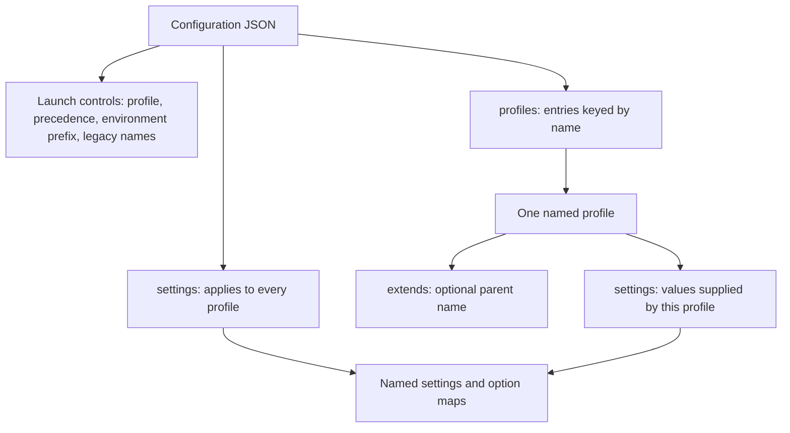
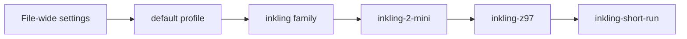
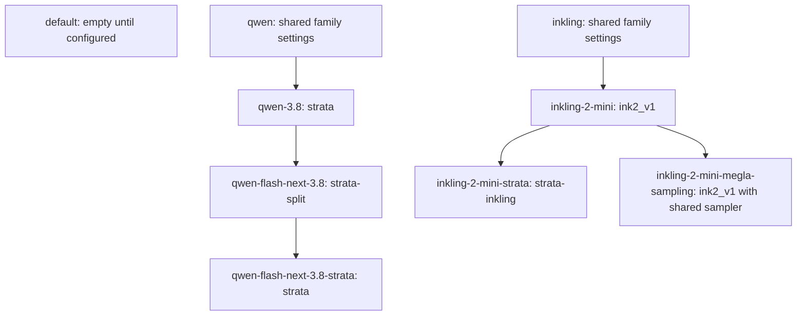
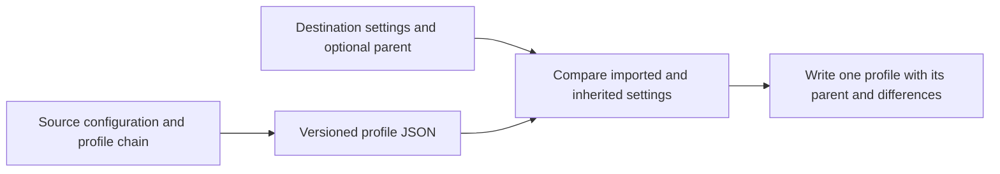
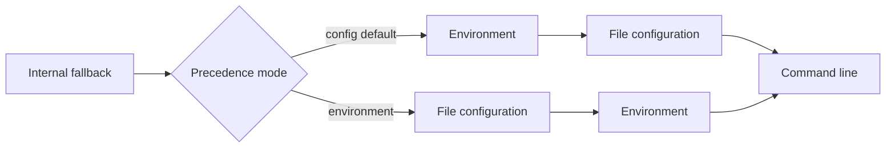
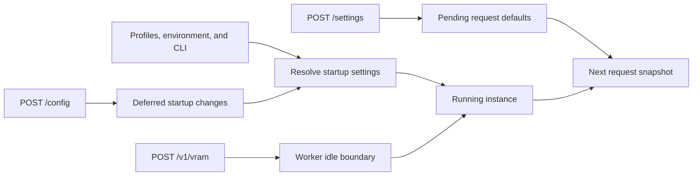

# Unified Scream P100 configuration

Use a JSON configuration file to keep model paths, hardware settings, and service options together. Use profiles to reuse those settings across models, machines, or test runs. The launcher resolves one set of settings before it starts a worker or HTTP adapter. **Configuration file** and **profile** are the canonical terms. Use `--cookbook` and `--recipe` as command-line aliases for `--config` and `--profile`. Both spellings use the same JSON keys and environment variables.

- [Start with a configuration file](#start-with-a-configuration-file)
- [File structure](#file-structure)
- [Profile inheritance](#profile-inheritance)
- [Built-in profiles and defaults](#built-in-profiles-and-defaults)
- [Export and import a profile](#export-and-import-a-profile)
- [Setting precedence](#setting-precedence)
- [Environment variables and command-line parameters](#environment-variables-and-command-line-parameters)
- [Legacy names](#legacy-names)
- [Startup and runtime](#startup-and-runtime)
- [Settings reference](#settings-reference)
- [Importing an existing Strata run](#importing-an-existing-strata-run)

## Start with a configuration file

Save this example as `cookbook.json`. Change `data_dir` to your Inkling model directory before starting the engine.

```json
{
  "profile": "inkling-z97",
  "environment_precedence": "config",
  "ignore_default_profile": false,
  "settings": {
    "host": "127.0.0.1"
  },
  "profiles": {
    "default": {
      "settings": {
        "port": 8080
      }
    },
    "inkling-z97": {
      "extends": "inkling-2-mini",
      "settings": {
        "data_dir": "/srv/models/inkling",
        "context": 32768,
        "env": {
          "ink2_ckpt_mb": "4096"
        }
      }
    },
    "inkling-short-run": {
      "extends": "inkling-z97",
      "settings": {
        "port": 8090,
        "num_passes": 2
      }
    }
  }
}
```

From the repository root, resolve the usual profile and the short-run profile without starting either one.

```sh
build-unified/scream-p100 --cookbook cookbook.json --print-settings
build-unified/scream-p100 --cookbook cookbook.json --recipe inkling-short-run --print-settings
```

Both resolve to `ink2_v1` with context `32768` and `INK2_CKPT_MB=4096`. The first resolves port `8080` and leaves the pass count to the backend. The second resolves port `8090` and two passes. For that reduced-pass Megla launch, the launcher omits its automatic DSpark path. Clear any inherited explicit `engine_options.mtp` or `engine_options.dump` before starting a reduced-pass profile.

To start the configured service, omit `--print-settings`. `bash run.sh --unified` accepts the same launcher arguments. An installed runtime uses `bin/scream-p100` from its installation prefix. See the [build and staging instructions](README.md#stage-an-isolated-runtime).

## File structure

Each file contains one JSON object. All top-level keys are optional. Use unique keys and standard JSON syntax.

| Top-level key | Type | Purpose |
| --- | --- | --- |
| `profile` | String or `null` | Selects the profile, including any parent profiles. With no selection, the launcher applies `default` unless default inheritance is disabled. |
| `environment_precedence` | `"config"` or `"environment"` | Chooses which wins when the file and the environment supply the same setting. The internal default is `"config"`. |
| `ignore_default_profile` | Boolean | Controls automatic use and inheritance of `default`. The internal default is `false`. |
| `environment_prefix` | String | Sets the prefix for launcher and component options. The default is `SP100`. Use uppercase letters, digits, and single underscores. |
| `legacy_names` | Boolean | Accepts legacy environment and direct CLI names in configured mode. The default is `false`. |
| `legacy_name_precedence` | `"canonical"` or `"legacy"` | Chooses the spelling that wins when both names are supplied in the same source. The default is `"canonical"`. |
| `settings` | Object | Provides settings for every profile selected from the file. |
| `profiles` | Object | Defines named profiles or adds settings to built-in profiles. |

Each entry under `profiles` can contain `extends` and `settings`. `extends` identifies one parent by name. Omit it to retain the built-in parent when customizing a built-in profile. Set it to `null` to clear that parent. `settings` uses the same keys as the file-wide `settings` object. Put selection and precedence controls at the top level.



## Profile inheritance

Within file configuration, the launcher applies imported Strata defaults first, then file-wide settings, then the default profile, then the selected profile's ancestry from the oldest parent to the selected child. Later settings win. Profiles can have one parent each and can form a chain of any depth. Unknown parents and inheritance cycles are rejected.



In the example, `default` supplies port `8080`, `inkling-2-mini` supplies the backend, and `inkling-z97` supplies the site paths and context. The last child changes the port and loop-pass count. Every other setting comes from its ancestors or a lower-priority source.

| Kind of setting | How layers combine |
| --- | --- |
| Named values such as `port`, `model`, and `num_passes` | Use the highest-priority value. A field that permits `null` can explicitly clear its inherited value. |
| `engine_options`, `server_options`, `env`, and `sampling` | Merge by key. An empty object keeps inherited keys. Clear individual entries with `null`. A higher-priority operand list replaces the full list for that flag. |
| `strata_settings` | Merge nested objects by key. A higher-priority array or scalar replaces the previous value at that key. |

Use `--ignore-default-profile`, `ignore_default_profile: true`, or `SP100_IGNORE_DEFAULT_PROFILE=true` to skip automatic inheritance of `default`. A child with `"extends": "default"` still inherits it. To use that profile on its own, select `--profile default`. Use `--no-ignore-default-profile` to restore automatic inheritance for one invocation.

`--ignore-default-recipe` and `--no-ignore-default-recipe` are also available.

## Built-in profiles and defaults

Edit [builtin_profiles.json](builtin_profiles.json) in source control to change the shipped profiles. Each entry uses the same `extends` and `settings` fields as a user profile. CMake copies the file into the build and packages it with the installed launcher. `build-unified/scream-p100 --profile inkling-2-mini-strata --print-settings` resolves the shipped profile without a separate user configuration file. A built-in profile supplies a backend or feature preset. Supply model files and machine-specific paths in your configuration.

The built-in `default` sets `vision_residency` to `auto`, which preloads and retains an enabled GPU projector and leaves the CPU lifecycle to the selected backend. Both model families inherit it. The fallback setting also uses `auto` when the default profile is skipped. Set the value in a child recipe to override it.



| Built-in profile | What it supplies |
| --- | --- |
| `default` | Shared settings for both families. Sets `vision_residency` to `auto`. |
| `qwen` | An empty family profile for shared Qwen settings. |
| `qwen-3.8` | Selects the Strata layer path. Its supported weights depend on the compiled architecture. |
| `qwen-flash-next-3.8` | Selects the two-card Scream Flash-Next split path. |
| `qwen-flash-next-3.8-strata` | Selects the upstream Strata layer path for Flash-Next. |
| `inkling` | An empty family profile for shared Inkling settings. |
| `inkling-2-mini` | Selects the Megla `ink2_v1` path. |
| `inkling-2-mini-megla-sampling` | Keeps `ink2_v1` and selects the shared Strata Inkling sampler. |
| `inkling-2-mini-strata` | Selects Strata Inkling. |

Defining `profiles.qwen.settings` in a file customizes the built-in `qwen` family profile, so its descendants inherit those settings. The same applies to `inkling`. A future model profile can extend the relevant family. An executable still needs a compatible loader and inference path for that model's architecture and weights.

**Internal fallback values** apply below every profile and configuration source. They include `host: "127.0.0.1"`, `port: 8080`, `mode: "serve"`, `sampler: "native"`, `tool_streaming: "native"`, and `vision_residency: "auto"`. The option maps start empty. The internal fallback leaves the backend, model, context, loop passes, and projector device unset. If no selected profile or override chooses a backend, startup requires a backend selection. The worker or adapter supplies its own defaults for settings left unset by the launcher.

## Export and import a profile

The export resolves the configuration file's shared settings, implicit default when enabled, and the selected profile's ancestors into one set of declared settings. The exchange file contains a format version, the profile name, and its settings. Runtime overrides and environment-provided setting values are outside the exchange. File paths and expressly configured environment-map values are exported as written or normalized by the resolver. The destination needs access to any referenced model files and Strata run files. Keep exports private if the configuration contains credentials.

```sh
scream-p100 --cookbook cookbook.json --recipe inkling-short-run --export-recipe inkling-short.json
scream-p100 --cookbook test-cookbook.json --import-recipe inkling-short.json \
    --recipe inkling-test --parent-recipe inkling-2-mini
scream-p100 --cookbook test-cookbook.json --recipe inkling-test --print-settings
```

`--export-profile`, `--import-profile`, and `--parent-profile` accept the same arguments. Export to `-` for standard output. A file export requires a new path. Import creates the destination file if it is missing and adds one entry under `profiles`. It uses the exported name unless you provide `--profile` or `--recipe`. Choose a new name if the cookbook already defines it or the application ships it as a built-in.

The imported profile inherits file-wide settings and any applicable default profile. `--parent-profile` adds the specified parent and its ancestors. The import only writes settings needed to reproduce the exported settings over that base. The parent supplies values absent from the export. Explicit `null` values can clear inherited settings where allowed. Equal values are retained when they are needed to resolve overlapping backend settings. After import, edits to the parent flow through to inherited settings.



## Setting precedence

Follow the branch for your precedence mode from lower to higher priority. Within **File configuration**, the selected child takes priority over its parents, and imported Strata defaults sit below file-wide settings.



The launcher establishes file discovery and naming before merging settings.

1. The launcher chooses the file from `--config`, then the active bootstrap prefix's `CONFIG` variable, then `SP100_CONFIG`. Set `--environment-prefix` or `SP100_ENVIRONMENT_PREFIX` to use a custom prefix during discovery. A prefix set inside the file applies after discovery.
2. The launcher reads naming controls from CLI flags, then the selected file, then the `SP100_ENVIRONMENT_PREFIX`, `SP100_LEGACY_NAMES`, and `SP100_LEGACY_NAME_PRECEDENCE` bootstrap variables, then its defaults. It resolves aliases before ranking values.
3. The launcher chooses source precedence from `--environment-precedence`, then the file's `environment_precedence`, then the active prefix's `ENVIRONMENT_PRECEDENCE` variable, then `config`. `profile` and `ignore_default_profile` follow the selected file and environment order, with CLI flags highest.

Using the example configuration, these commands resolve port `8090`, `9160`, and `9224` respectively.

```sh
SP100_PORT=9160 build-unified/scream-p100 --config profiles.json --profile inkling-short-run --print-settings
SP100_PORT=9160 build-unified/scream-p100 --config profiles.json --profile inkling-short-run \
  --environment-precedence environment --print-settings
SP100_PORT=9160 build-unified/scream-p100 --config profiles.json --profile inkling-short-run \
  --environment-precedence environment --port 9224 --print-settings
```

`--print-settings` shows the resolved profile, precedence mode, default-profile control, and launcher settings. It can include configured credentials. Adapter resource planning and native defaults apply during launch.

## Environment variables and command-line parameters

### Environment variables

The default environment prefix is `SP100`. Named settings use `snake_case` in JSON, `--kebab-case` on the command line, and `PREFIX_UPPER_SNAKE_CASE` in the environment. A file with `"environment_prefix": "MY_ENGINE"` reads `MY_ENGINE_NUM_PASSES` for `num_passes`.

| Value type | Example |
| --- | --- |
| File path or other string | `SP100_CONFIG=/etc/scream/profiles.json`, `SP100_PROFILE=inkling-z97`, `SP100_VISION_DEVICE=cpu` |
| Integer | `SP100_PORT=9160`, `SP100_CONTEXT=32768`, `SP100_NUM_PASSES=2` |
| Boolean control | `SP100_IGNORE_DEFAULT_PROFILE=true` |
| Map of worker flags | `SP100_ENGINE_OPTIONS='{"parallel":2}'` for a Strata Inkling profile |
| Map of worker environment variables | `SP100_ENV='{"ink2_ckpt_mb":"8192"}'` |
| Map of sampling defaults | `SP100_SAMPLING='{"temperature":0.7,"top_k":32}'` for a profile that supports those defaults |
| Individual map members | `SP100_ENGINE_OPTIONS__PARALLEL=2`, `SP100_SAMPLING__TEMPERATURE=0.7`, `SP100_ENV__INK2_CKPT_MB=8192` |

Use `__` to specify one member of `engine_options`, `server_options`, `sampling`, or `env`. It takes priority over the same member in the whole environment map. Member values use JSON syntax except in `ENV__`, where values are literal text. Use whole-object JSON for `strata_settings`.

The `env` map sends backend variables such as `ink2_ckpt_mb` or `cuda_visible_devices` to the component that consumes them. A boolean becomes `1` or `0`. `null` in a JSON map removes an inherited variable when that entry wins. Ordinary inherited process variables participate in source precedence. Launcher-managed values remain reserved.

Some native flags correspond to existing environment variables. The launcher resolves these pairs using the same source priorities. With legacy names enabled, the canonical flag form wins a conflict within the environment source unless legacy spelling takes precedence.

| Backend | Native flag | Environment variable |
| --- | --- | --- |
| `strata-split` | `--rope-scale` | `FNX_ROPE_SCALE` |
| `strata-inkling` | `--gpus`, `--devices` | `IK2_GPUS` |
| `strata-inkling` | `--ep-split` | `IK2_EP_SPLIT` |
| `strata-inkling` | `--draft-beam` | `STRATA_INK_SPEC_BEAM` |
| `strata-inkling` | `--draft-cost` | `STRATA_INK_SPEC_COST` |
| `strata-inkling` | `--draft-plain` | `STRATA_INK_SPEC_PLAIN` |

### Command-line parameters

Use named flags for scalar settings, such as `--host`, `--port`, `--num-passes`, and `--vision-device`. Use `--engine-options`, `--server-options`, `--sampling`, `--env`, or `--strata-settings` with a JSON object. Use `--set 'KEY=JSON'` for `null` or one map entry. Repeat `--set` to combine overrides. If the same named scalar is supplied via a named flag and `--set`, the named flag wins.

```sh
build-unified/scream-p100 --config profiles.json --profile inkling-short-run \
  --port 9224 --set 'env.ink2_ckpt_mb="8192"' --set 'engine_options.mtp=null' \
  --print-settings
```

`--set` accepts one map key after the first dot. To update a nested Strata object, pass that object's JSON, for example `--set 'strata_settings.vision={"threads":2}'`. Other keys in the inherited `vision` object are retained.

In `engine_options` and `server_options`, use the `snake_case` form of the component's flag. For example, `max_queue` passes `--max-queue` to the server. Existing literal flag keys in maps and saved Strata argument arrays remain valid.

| JSON value | Result |
| --- | --- |
| `true` | Emits the flag by itself. |
| `false` or `null` | Removes the flag, including an inherited setting. |
| `2` or `"some path"` | Emits the flag with one operand. A path with spaces stays one operand. |
| `[4, 44]` | Emits the flag with two operands. |
| `[["a.gguf"], ["b.gguf"]]` | Emits two instances of a flag that accepts repeated occurrences. |

On Strata Inkling, `--parallel`, `--batch`, and `--slots` refer to the same setting. So do `--kv` and `--kv-dtype`. The launcher reserves named worker arguments such as the model, context, and loop passes, and the listener's host and port. Supply these through their named settings. Keep the component-specific flags in the map for the component that receives them.

At the native executable, `--backend NAME` as the first argument selects the raw worker argument interface. Use `--configured --backend NAME` to select the backend and still apply profiles, file settings, and launcher environment variables. Use `--mode native` with the launcher to run a native command with resolved settings. The default `serve` mode starts the HTTP adapter and its worker.

## Legacy names

Use `--legacy-names` or set `"legacy_names": true` at the top level of your configuration. `--no-legacy-names` overrides a file that enables aliases. To discover a file through `SCREAM_CONFIG`, enable legacy names first with `--legacy-names` or `SP100_LEGACY_NAMES=true`.

| Legacy input | Canonical setting | Canonical CLI and environment |
| --- | --- | --- |
| `--ctx`, `--max-context`, or `SCREAM_CONTEXT` | `context` | `--context`, `SP100_CONTEXT` |
| `--native` or `SCREAM_MODEL` | `model` | `--model`, `SP100_MODEL` |
| `INK2_VISION_DEVICE` | `vision_device` | `--vision-device`, `SP100_VISION_DEVICE` |
| `INK2_STREAM_TOOL_ARGUMENTS=1` | `tool_streaming` | `--tool-streaming incremental`, `SP100_TOOL_STREAMING=incremental` |
| `INK2_CKPT_MB` | `env.ink2_ckpt_mb` | `--set 'env.ink2_ckpt_mb=8192'`, `SP100_ENV__INK2_CKPT_MB=8192` |
| `--lazy` | `server_options.lazy` | `--set 'server_options.lazy=true'`, `SP100_SERVER_OPTIONS__LAZY=true` |

The launcher accepts old `SCREAM_` names for named settings and inherits legacy backend variables in compatibility mode. Direct legacy flags resolve to the matching named setting or pass through to their worker or adapter. When a flag has a different meaning in the worker and server, use `engine_options` or `server_options` to identify the target. The explicit mappings are in [config_names.py](config_names.py).

If both spellings are supplied in the same source, the launcher warns on standard error and uses the canonical spelling. Set `--legacy-name-precedence legacy` or `"legacy_name_precedence": "legacy"` to prefer the old spelling. CLI overrides still take priority over file and environment values. Raw backend commands, standalone scripts, and imported Strata files use their existing interfaces.

## Startup and runtime

Configured launches use the same launcher resolver for both HTTP and native mode. The launcher first finds the JSON file and selects the profile and backend. For Strata, it reads the selected saved run before resolving the final values. It then turns those values into worker flags, process environment, and adapter settings. The adapter can also apply model defaults, device planning, and saved Strata tuning where supported. `--print-settings` shows the launcher's values before this step. Raw backend commands and the standalone scripts use their own argument handling.

For the staged Strata layer adapter, saved tuning supplies startup defaults. Explicit worker flags and resolved environment values keep priority. An imported Strata run's `env` applies to the worker. Use the unified `settings.env` map to configure the adapter's environment.

Changing the profile file, parent shell environment, or CLI arguments takes effect when the unified launcher is started again. This includes the model, profile, listener, context, loop passes, worker layout, and projector device. Requests can supply supported sampling and generation options for that request.

The staged Strata HTTP adapter exposes runtime controls through the instance's settings store. A valid `POST /settings` queues replacement shared defaults such as temperature, reasoning effort, and token limits. Generation requests take a snapshot before preparation. The first request to finish generation successfully with the latest update clears its pending status. Rejected or cancelled requests leave it pending. Earlier requests keep their original snapshot. Explicit request values take priority. `GET /settings` shows the accepted defaults and whether they are pending.

`POST /config` queues supported startup settings for the next configured launch. `GET /config` shows the proposed startup values. Deferred edits apply after file profiles at configuration priority. The configured environment precedence and CLI overrides still apply. Changes are saved under `scream-p100/instances` in the absolute directory set by `XDG_STATE_HOME`, with `~/.local/state` as the fallback. A new launch loads only the matching instance, based on its configuration, profile, worker, and listener. The source files remain independently editable. Diagnostics use the running startup snapshot.

`POST /v1/load` and `/v1/unload` control the existing model's residency. On workers that support elastic VRAM, `POST /v1/vram` waits for the worker's idle boundary and then applies the reserve. If the model is unloaded, the reserve is applied at its next load. Megla exposes per-request options through its generation API.



## Setting names

For example, `num_passes`, `--num-passes`, and `SP100_NUM_PASSES` all refer to the same setting. Use the JSON name with `--set`.

The imported Strata run format, native argument maps, and HTTP fields retain their own names. For example, launcher `context` maps to Megla `--ctx` or Strata `--max-context`. The unified `sampling` block uses `repetition_penalty` and `penalty_last_n`, while an imported Strata sampling block can use `repeat_penalty` and `repeat_last_n`. Launcher `backend` selects an engine implementation. Strata's run-file `backend` describes its compute platform, such as `cuda` or `cpu`.

## Settings reference

The [settings reference](SETTINGS.md) lists the canonical names, their full configuration paths, the CLI and environment forms, valid values, related settings, and legacy aliases.

```sh
build-unified/scream-p100 --help
build-unified/scream-p100 --help-settings
build-unified/scream-p100 --help-settings context
build-unified/scream-p100 --help-settings strata_settings.vision.mmproj
build-unified/scream-p100 --help-settings=--ctx
```

`--help` lists the main options. `--help-settings` displays the full reference or looks up one name. Use a canonical name, a JSON path like `settings.sampling.seed`, an environment variable, or a known legacy alias. Supply `--environment-prefix` to show and look up names under a custom prefix. Help reads the packaged reference on demand before configuration discovery. Normal launches read the profile data and start without loading the help catalog.

### Backend option interfaces

The reference covers the launcher and its named map members. The maps also accept additional options supported by the selected backend. For an extra worker flag such as `--example-flag`, the configured forms are `settings.engine_options.example_flag`, `--set 'engine_options.example_flag=JSON'`, and `SP100_ENGINE_OPTIONS__EXAMPLE_FLAG`. Use the selected backend's own option name and operand rules.

- For the upstream Strata layer and Inkling workers, use `scream-p100 --backend strata --help` or `scream-p100 --backend strata-inkling --help`.
- For the Scream build's additional options, see the [Flash-Next switches](../docs/SWITCHES.md), [Megla switches](../docs/INKLING2.md#switches-ink2_-environment-of-the-engine), and the raw argument parsers for [Flash-Next split](../engine/tools/sfnx.cpp) and [Megla](../engine-inkling2/src/ink2_v1.cu).
- For the configured Strata HTTP adapter's additional options, use `python3 serve/server.py --help` from its staged terminal directory. The installed copy is under `libexec/scream-p100/strata-terminal`.

### Editing the reference

Edit [settings_reference.json](settings_reference.json) in source control. The top-level object has `version` (currently `1`) and an `entries` object keyed by canonical name. Use dotted paths for map members.

| Entry field | Contents |
| --- | --- |
| `kind` | `setting` for values under `settings` or a profile's settings, `control` for a top-level launch control, `discovery` for file selection, `document` for JSON-only structure, or `command` for CLI-only actions. |
| `summary` | A short description of what the entry controls. |
| `values` | Valid types, ranges or choices, the default where applicable, and backend prerequisites. |
| `related` | Optional list of other canonical entries. Every name must exist. |
| `aliases` | Optional notes for historical spellings or backend-specific differences. Common aliases come directly from the resolver. |
| `lookup_aliases` | Optional exact additional spellings that `--help-settings` can look up. |

Regenerate the Markdown reference and run the tests after editing the catalog.

```sh
python3 unified/settings_help.py > unified/SETTINGS.md
python3 -m unittest discover -s unified -v
```

The tests check the reference structure, named setting and sampler coverage, generated Markdown, help lookup, and operation from a relocated install. CMake includes the JSON catalog with the launcher and installs the Markdown beside the configuration guide.

## Importing an existing Strata run

For the Strata backends, set `strata_config` to an existing run JSON or supply its adapter fields through `strata_settings`. Use `strata_settings` for fields such as `tokenizer`, `cwd`, `model_name`, and `vision`. Use the launcher's named settings and `engine_options` for fields it owns. The keys `exe`, `args`, `env`, `host`, and `port` are reserved inside `strata_settings`.

The saved file's `host`, `port`, worker `env`, and recognized `sampling` defaults participate at the bottom of file configuration. The launcher applies the selected source order when overriding those values. In an imported `args` array, `["--batch", "2"]` and `["--batch=2"]` are equivalent. Relative tokenizer, model, and vision shard paths use the configured worker directory. The HTTP adapter also applies its resource and drafter planning.

This example selects a saved Flash-Next split run and gives the validation profile a separate loopback port and context limit.

```json
{
  "profile": "flash-next-z97-test",
  "profiles": {
    "flash-next-z97-test": {
      "extends": "qwen-flash-next-3.8",
      "settings": {
        "strata_config": "/srv/models/flash-next/strata-run.json",
        "host": "127.0.0.1",
        "port": 8180,
        "context": 8192
      }
    }
  }
}
```

See the [shared and fallback worker settings](README.md#backend-specific-settings) for a Strata split run with `split_fallback`.
